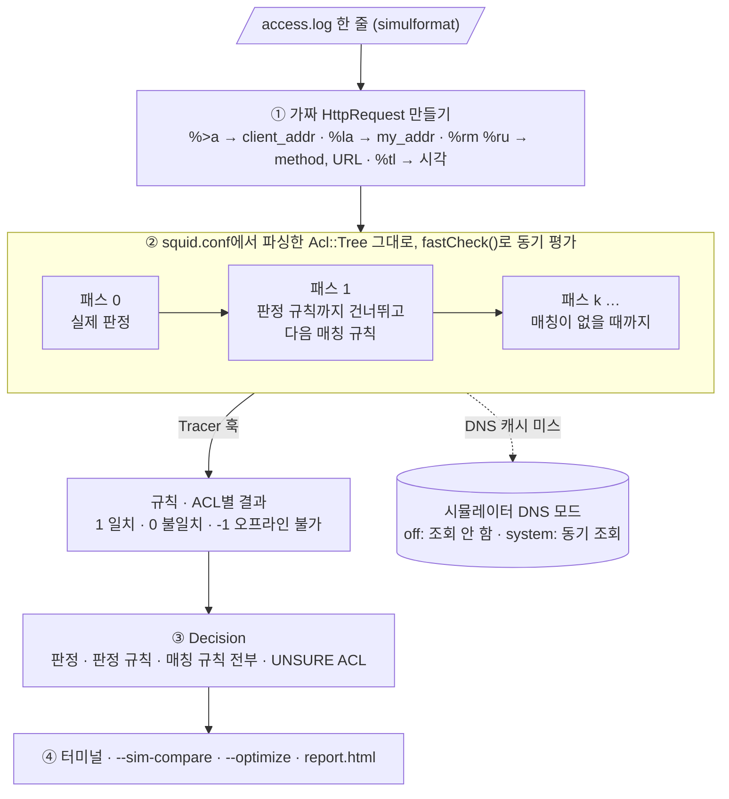
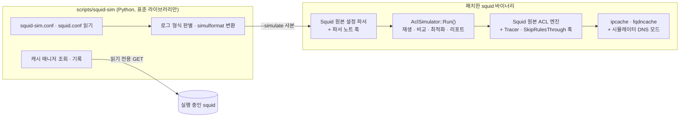

# squid-simulator

**squid.conf와 access.log를 넣으면, 요청마다 어떤 `http_access` 규칙이 허용·차단했는지 보여주는 오프라인 시뮬레이터입니다.**
Squid 소스에 패치로 붙어서, 판정은 Squid 자신의 설정 파서와 ACL 엔진이 그대로 내립니다.
소켓을 열거나 트래픽을 보내지 않으므로, 운영 중인 squid 옆에서 실행해도 됩니다.

| 기능 | 옵션 | 알 수 있는 것 |
|---|---|---|
| 요청별 판정 | `--simulate access.log` | 판정한 규칙, 그 요청에 매칭되는 다른 규칙 전부, 그 규칙이 없었다면의 결과, 실제 로그와의 일치 여부 |
| 설정 비교 | `--sim-compare new.conf` | 새 squid.conf로 바꾸면 판정이나 판정 규칙이 달라지는 요청 |
| 최적화 | `--optimize` | 쓰이지 않는 ACL, 이미 포함된 값, 서로 겹치거나 포함되는 ACL, 도달할 수 없거나 중복·일부 가려진 규칙, 내장 ACL 재정의 |
| 리포트 | `--report out.html` | 위 결과 전체를 담은 HTML 한 파일 (검색·필터, 규칙별 평가 과정) |
| 캐시 매니저 | `squid-sim -m [--report 60m]` | 실행 중인 squid의 클라이언트, DNS 조회·실패, 진행 중 요청, 분당 요청을 localhost 같은 잡음 없이 조회하거나 기록 |

모든 기능은 `scripts/squid-sim` 하나로 실행합니다. `-m`이 없으면 인자를 패치한 squid로 넘기고, `-m`이 있으면
실행 중인 squid의 캐시 매니저(`/squid-internal-mgr/`)를 읽습니다. 사이트마다 다른 로그 형식, 대상 squid.conf와
로그 경로는 시뮬레이터 전용 설정 파일 [`squid-sim.conf`](squid-sim.conf)에서 관리합니다.
전체 구성도와 기능별 흐름도(판정, 비교, 최적화, 로그 형식, 매니저, 빌드·검증)는 [docs/OVERVIEW.md](docs/OVERVIEW.md)에 모아 두었습니다.

## 이런 질문에 답합니다

| 상황 | 쓰는 기능 |
|---|---|
| "이 사용자가 이 사이트에 왜 막혔지? 어느 줄 때문이지?" | `--simulate`: 판정 규칙과 원문 줄, 그 규칙이 없었다면의 결과 |
| "squid.conf를 이렇게 바꾸면 누가 새로 막히거나 풀리지?" | `--sim-compare new.conf`: 어제 로그를 새 설정으로 다시 돌려 바뀌는 요청만 |
| "쓰이지 않거나, 겹치거나, 절대 안 걸리는 규칙이 있나?" | `--optimize`: ACL 값까지 비교해 중복·도달 불가·일부 가려진 규칙 |
| "보고용으로 한 번에 정리해 줘" | `--report out.html`: 위 결과 전체를 HTML 한 파일로 |
| "지금 실제로 누가 프록시를 쓰고 어떤 도메인 조회가 실패하지?" | `squid-sim -m [--report 60m]`: 실행 중인 squid를 잡음 없이 조회·기록 |

## 목차

- [브랜치](#브랜치) · [빠른 시작](#빠른-시작) · [출력 예시](#출력-예시)
- [Squid는 http_access를 어떻게 판정하나](#squid는-http_access를-어떻게-판정하나) · [시뮬레이터는 이것을 어떻게 흉내 내나](#시뮬레이터는-이것을-어떻게-흉내-내나)
- [설계 상세](#설계-상세): 원칙, 구성 요소, 가짜 요청, 관찰 훅, 다중 패스, 시간, DNS, 비교, 최적화, 로그 형식, 매니저, 리포트
- [squid 4.10과 7.7의 차이](#squid-410과-77의-차이) · [검증 방법](#검증-방법) · [운영 중인 squid에 주는 영향](#운영-중인-squid에-주는-영향) · [정확도와 한계](#정확도와-한계)

## 브랜치

Squid 내부 API는 메이저 버전마다 달라서, 배포판의 squid 버전마다 브랜치를 나눕니다.

| 브랜치 | 대상 OS | squid | 검증 |
|---|---|---|---|
| `main` | Ubuntu 20.04 LTS | 4.10 | Ubuntu 20.04.6에서 빌드·`make check` 94 PASS·기능 테스트 49개·배포판 squid 비교 통과 |
| [`ubuntu-26.04-squid-7.7`](https://github.com/hyeonsa-claude/squid-simulator/tree/ubuntu-26.04-squid-7.7) | Ubuntu 26.04 LTS | 7.7 | Ubuntu 26.04.1에서 빌드·`make check` 103 PASS·기능 테스트 54개·배포판 squid 비교 통과 |

## 빠른 시작

### 1. 로그 형식 (squid-sim.conf)

운영 squid.conf의 로그 설정은 바꾸지 않아도 됩니다. `scripts/squid-sim`이 로그 형식을 정해 시뮬레이터가 읽는
`simulformat`으로 바꿔 넣습니다. 형식은 시뮬레이터 전용 설정 파일 `squid-sim.conf`가 정하며, 기본값 `auto`는
squid.conf의 `access_log`가 쓰는 형식과 미리 정의된 형식(`squid`, `common`, `combined` 등)을 로그에 맞춰 보고 고릅니다.
직접 정의한 형식은 squid.conf의 `logformat` 줄을 복사해 넣습니다 (`/etc/squid/squid-sim.conf`):

```
squid_conf    /etc/squid/squid.conf
access_log    /var/log/squid/access.log
logformat     site %>a %la [%tg] %Ss/%03>Hs %<st "%rm %ru" %tr "%{User-Agent}>h" %un
log_format    site
log_timezone  +0900       # %tg, %ts는 UTC라서 프록시 타임존이 필요
```

`%>a`와 `%ru`만 있으면 되고, `%tl`, `%la`, `%rm`, `%Ss`가 있으면 시각 ACL, `localip`, 메서드, 실제 로그와의 비교까지 정확해집니다.
가장 정확한 형식은 이 필드를 모두 담은 `simulformat`입니다:
`logformat simulformat %tl %la %>a  "%rm %ru HTTP/%rv" %>Hs %<st %Ss:%Sh`. 자세한 내용은 [docs/LOGFORMAT.md](docs/LOGFORMAT.md)에 있습니다.

### 2. 빌드

```bash
git clone https://github.com/hyeonsa-claude/squid-simulator.git
cd squid-simulator
scripts/build.sh --deps        # 빌드 패키지 설치(sudo) → 공식 소스 다운로드·SHA-256 확인 → 패치 → 빌드
```

패치된 바이너리는 `build/squid-4.10/src/squid`입니다. `make install`은 하지 않으며, 시스템의 squid는 건드리지 않습니다.
설치된 squid와 비교까지 한 번에 검증하려면 `scripts/verify-target.sh`를 실행합니다.

### 3. 시뮬레이션

```bash
S=scripts/squid-sim          # build/squid-4.10/src/squid를 찾아 실행
sudo $S                                                                     # squid-sim.conf의 squid.conf + access.log
$S -f /etc/squid/squid.conf --simulate /var/log/squid/access.log            # 요청별 판정
$S --simulate access.log.2.gz --report old.html                             # 다른 형식·gzip 로그도 그대로
$S -f /etc/squid/squid.conf --simulate access.log --sim-compare new.conf    # 설정 비교
$S -f /etc/squid/squid.conf --optimize                                      # 최적화 항목
$S -f /etc/squid/squid.conf --simulate access.log --sim-compare new.conf \
   --optimize --report report.html                                          # 전체 리포트
```

### 4. 실행 중인 squid 살펴보기 (캐시 매니저)

```bash
$S -m                                   # 클라이언트, DNS, 진행 중 요청, 카운터 요약
$S -m --page ipcache                    # curl http://127.0.0.1:8090/squid-internal-mgr/ipcache 대신
$S -m --url http://127.0.0.1:8090 --report 60m     # 60분 동안 60초마다 기록 → report.html, summary.txt
```

localhost 클라이언트, `/etc/hosts` 고정 항목, 매니저 조회 자신은 빼고 보여주며, 요청 수에서도 조회 횟수를 뺍니다.
상태를 바꾸는 매니저 동작(`shutdown`, `reconfigure` 등)은 거부합니다. 자세한 내용은 [docs/MANAGER.md](docs/MANAGER.md)에 있습니다.

```text
requests 72  (avg 24.0/min, peak 42.0/min)  errors 43  hits 11  sent 1447 KB

top clients:
  192.168.50.25                                  32  TCP_DENIED 32

DNS names resolved (new = not cached when recording started):
  example.com                                   104.20.23.154 172.66.147.243 …  NEW
  no-such-host-1.invalid                        -  NEW  FAILED
```

## 출력 예시

아래는 저장소의 테스트 설정·로그(`tests/`)로 실제 실행한 결과입니다.

**요청별 판정** (`--simulate`, `--sim-trace`를 붙이면 규칙별 평가 과정까지 표시)

```text
      4  DENY   http_access#3     10.0.0.5  GET http://x.ads.example.com/a.js  (log TCP_DENIED/403: same)
           decided by: http_access deny blocked
           matching:   #3 deny > #5 allow > #7 allow > #10 deny > #11 allow > #12 allow   | without #3: ALLOW by http_access#5
             #1    no     !Safe_ports=no   [http_access deny !Safe_ports]
             #2    no     CONNECT=no   [http_access deny CONNECT !SSL_ports]
             #3    MATCH  blocked=yes   [http_access deny blocked]
```

- `decided by`: 판정한 규칙(squid.conf 원문)
- `matching`: 이 요청에 매칭되는 모든 규칙. 차단됐다면 뒤쪽 `allow`가 "막히지 않았다면 허용했을 규칙"
- `without #3`: 판정 규칙을 지웠을 때의 결과
- `(log …: same)`: 실제 로그의 결과 코드와 비교. `same`, `DIFF`, `UNSURE`(로그만으로 판정할 수 없는 ACL 포함)

**설정 비교** (`--sim-compare`)

```text
      9  ALLOW -> DENY   VERDICT  10.0.0.5  GET http://www.facebook.com/
           current: #5       http_access allow localnet
           new:     #4       http_access deny social
```

**최적화** (`--optimize`)

```text
  HIGH    unreachable rule             http_access#12
          every request it matches is decided first by http_access#3 [http_access deny blocked] with the opposite action
          at:  http_access allow blocked localnet
          fix: move it above http_access#3 or delete it
  LOW     covered by a wider entry     localnet
          '10.1.0.0/16' is already covered by '10.0.0.0/8'
          at:  tests/squid.conf:11  acl localnet src 10.1.0.0/16
          fix: delete the narrower entry
```

## Squid는 `http_access`를 어떻게 판정하나

운영 중인 squid에서 요청 하나가 판정되는 경로입니다. 시뮬레이터가 그대로 쓰는 부분과 대신하는 부분을 이해하는 데 필요합니다.


판정 규칙의 핵심:

1. squid.conf의 `http_access` 줄들은 하나의 **OR 트리**(`Acl::Tree`)가 되고, 각 줄은 그 아래 **AND 노드**(`http_access#N`)가 됩니다.
   줄의 ACL 이름들이 AND 노드의 자식이며, `!acl`은 NOT 노드로 감쌉니다.
2. `OrNode::doMatch()`가 규칙을 위에서부터 차례로 평가하고, **처음 매칭된 규칙의 allow/deny가 판정**입니다.
   AND 노드는 첫 불일치에서 멈춥니다(단락 평가).
3. 어떤 규칙도 매칭되지 않으면 **마지막 규칙의 반대**가 판정입니다(implicit rule).
4. DNS나 helper가 필요한 ACL은 `goAsync()`로 검사를 멈췄다가, 답이 오면 이어서 평가합니다.

## 시뮬레이터는 이것을 어떻게 흉내 내나

설정 파싱까지는 운영 squid와 똑같이 진행한 뒤, 데몬화·포트 오픈·캐시 초기화 **전에** 시뮬레이터로 갈라집니다.
판정 로직은 바꾸지 않고, 입력을 로그로 바꾸고 관찰용 훅을 붙였습니다.



| 운영 squid | 시뮬레이터 |
|---|---|
| 소켓에서 요청을 읽고 파싱 | 로그 한 줄로 `HttpRequest::FromUrl()` 호출, 주소·포트·시각을 채움 |
| `nonBlockingCheck()`: DNS·helper 응답을 기다림 | `fastCheck()`: 기다리지 않음. 기다려야 하는 ACL은 `UNSURE`로 표시 |
| 현재 시각으로 `acl time` 평가 | 로그의 `%tl` 시각과 UTC 오프셋으로 평가 |
| DNS 비동기 조회 | `hosts_file`만 사용(기본) 또는 OS 리졸버로 동기 조회(`--sim-dns system`) |
| 처음 매칭된 규칙에서 끝 | 같은 판정 뒤에, 앞 규칙을 건너뛰며 다시 평가해 매칭되는 규칙을 모두 찾음 |
| 전달하거나 오류 페이지 응답 | 판정과 규칙만 기록하고 다음 줄로 |

### 매칭되는 모든 규칙을 찾는 방법

Squid는 첫 매칭에서 멈추므로, 뒤에서 허용했을 규칙을 알려면 다시 평가해야 합니다.
`OrNode::doMatch()`는 규칙마다 `Acl::Tree::bannedAction()`에 "이 규칙을 건너뛸까"를 묻는데, 여기에 위치 조건 하나
(`SkipRulesThrough`)를 더했습니다. 위 예시의 4번 줄(`x.ads.example.com`)은 이렇게 평가됩니다.

| 패스 | 건너뛰는 규칙 | 매칭 | 의미 |
|---|---|---|---|
| 0 | 없음 | `#3 deny blocked` | 실제 판정 (운영 squid와 같은 평가) |
| 1 | #1 ~ #3 | `#5 allow localnet` | #3이 없었다면 허용 |
| 2 | #1 ~ #5 | `#7 allow localnet Safe_ports` | |
| … | … | `#10`, `#11`, `#12` | |
| 6 | #1 ~ #12 | 없음 | 종료 |

승자 앞의 규칙은 이미 불일치였으므로 "승자까지 건너뛰기"는 "승자 다음부터 계속"과 같습니다. 판정에 쓰이는 것은 패스 0뿐이고,
`UNSURE` 여부도 패스 0에서 실제로 평가된 ACL만으로 정합니다.

### 수정한 Squid 소스

| 위치 | 하는 일 | 옵션 없이 실행할 때 |
|---|---|---|
| `src/AclSimulator.cci` (신규) | 로그 파싱, 다중 패스 평가, 비교, 최적화, 출력. `main.cc`가 포함 | 실행 안 됨 |
| `src/main.cc` | 옵션 7개, 설정 파싱 직후 `AclSimulator::Run()` | 영향 없음 |
| `src/acl/Checklist.{h,cc}` | `Tracer` 훅 (`matchChild()`, `goAsync()`), `SkipRulesThrough` | 꺼져 있음 |
| `src/acl/Tree.cc` | `bannedAction()`의 위치 조건 | 꺼져 있음 |
| `src/acl/{Acl,InnerNode,DomainData,Ip,RegexData}.cc` | Squid가 이미 내던 중복·포함 경고와 ACL 참조를 기록 (`--optimize`용) | 기록 안 함 |
| `src/ipcache.cc`, `src/fqdncache.cc` | DNS 캐시 미스 시 조회 생략 또는 동기 조회 | 기존 비동기 조회 |
| `src/cache_cf.cc`, `src/globals.h` | 설정이 가리키는 파일(예: `mime.conf`)이 없어도 `-k parse`처럼 계속 진행, 시뮬레이터 모드에서는 `cache_log`를 열지 않음 | 기존 동작 |
| `src/external_acl.cc` | helper가 없을 때의 NULL 역참조 방지 | 운영 중엔 해당 없음 |

자세한 설명은 [docs/DESIGN.md](docs/DESIGN.md)에 있습니다.

## 설계 상세

### 설계 원칙

| 원칙 | 이유 | 구현 |
|---|---|---|
| 판정 로직을 다시 만들지 않는다 | ACL 문법·매칭 규칙을 재구현하면 버전마다 미묘하게 달라지고, 그 차이가 곧 오판이 된다 | 시뮬레이터는 Squid 자신의 설정 파서와 `ACLChecklist::fastCheck()`를 그대로 호출하고, 입력과 관찰만 바꾼다 |
| 훅은 기본값에서 아무 일도 하지 않는다 | 같은 바이너리를 운영 squid로 써도 동작이 같아야 한다 | 모든 훅은 `nullptr`, `-1`, `false`, `0`이 기본이고, `--simulate`·`--optimize`일 때만 켜진다 |
| 빌드 시스템을 고치지 않는다 | 배포판 configure 옵션 그대로 빌드해야 배포판 squid와 비교할 수 있다 | 새 코드는 `main.cc`가 `#include` 하는 `AclSimulator.cci` 한 파일. `make check`의 헤더 단독 컴파일도 피한다 |
| 운영 중인 squid를 건드리지 않는다 | 운영 서버에서 바로 돌려 볼 수 있어야 한다 | 설정 파싱 직후, PID 파일·포트·캐시·`cache_log`를 열기 전에 갈라진다 |
| 모르는 것은 추측하지 않는다 | 틀린 확신이 모르는 것보다 위험하다 | 로그에 없는 정보가 필요한 ACL은 `UNSURE`, 값을 읽지 못한 ACL은 비교에서 뺀다 |

### 구성 요소



두 층으로 나눈 이유는 역할이 다르기 때문입니다. **판정**은 Squid 내부 API가 필요해 C++ 패치로, **로그 형식·설정 파일·매니저**처럼
Squid 버전과 무관한 일은 Python 한 파일로 두었습니다. 그래서 4.10과 7.7 브랜치는 C++ 패치만 다르고 `squid-sim`은 같습니다.

### 1. 로그 한 줄을 가짜 요청으로

`ReadLog()`가 `simulformat` 줄을 위치로 읽어 `Record`를 만들고, `Evaluate()`가 운영 squid가 소켓에서 만들었을 `HttpRequest`를 재구성합니다.

| 로그 필드 | 들어가는 곳 | 영향받는 ACL |
|---|---|---|
| `%>a` | `request->client_addr`, `indirect_client_addr`, `al->cache.caddr` | `src`, `srcdomain` |
| `%la` + `--sim-port`(기본 첫 `http_port`) | `request->my_addr` | `localip`(`myip`), `localport` |
| 그 포트의 `http_port name=` | `request->myportname` | `myportname` |
| `%rm`, `%ru` | `HttpRequest::FromUrl()` (CONNECT는 `호스트:포트`) | `method`, `dstdomain`, `dst`, `port`, `proto`, `url_regex`, `urlpath_regex` |
| `%rv` | `request->http_ver` | — |
| `%tl` | `squid_curtime`, `current_time`, 프로세스 `TZ` | `time` |
| `%Ss` | 입력에는 쓰지 않고, 판정과 비교(`same`/`DIFF`)에만 | — |

읽을 수 없는 줄도 버리지 않고 줄 번호와 함께 `SKIP`으로 남겨, 결과의 줄 번호가 원본 로그와 항상 같습니다.

### 2. 엔진 관찰: `ACLChecklist::Tracer`

Squid는 `http_access` 줄들을 OR 트리(`Acl::Tree`) 아래 줄마다 AND 노드(`http_access#N`)로 만들고, 자식을 평가할 때마다
`ACLChecklist::matchChild()`를 거칩니다. 여기에 정적 함수 포인터 `Tracer(부모, 노드, 결과)` 호출을 넣었습니다.

- 부모가 트리인 이벤트 = **규칙 단위 결과**, 부모가 규칙인 이벤트 = **ACL 단위 결과**입니다. AND 노드는 첫 불일치에서 멈추므로
  기록도 Squid의 단락 평가 순서를 그대로 따릅니다(`--sim-trace`, 리포트의 평가 과정).
- `fastCheck()`에서 비동기 조회가 필요해 `goAsync()`가 거절되면 결과 `-1`을 보내고, 그 ACL을 `UNSURE`로 표시합니다.
- 로그에 없는 데이터를 보는 32개 타입(`browser`, `req_header`, `proxy_auth`, `external`, `maxconn`, `note` 등)은 결과가 나와도 `UNSURE`입니다.
- `UNSURE`는 **패스 0에서 판정 규칙까지 실제로 평가된 ACL만**으로 정합니다. 판정에 영향을 줄 수 없는 ACL로 경고하지 않기 위해서입니다.
  AUTH·DUNNO로 끝났으면 그 판정을 낸 ACL을, 로그 시각이 없으면 평가된 `time` ACL을 더합니다.

### 3. 매칭되는 모든 규칙: `SkipRulesThrough`

Squid는 첫 매칭에서 멈추므로, 뒤에서 매칭될 규칙을 알려면 다시 평가해야 합니다. `OrNode::doMatch()`는 규칙마다
`Acl::Tree::bannedAction()`에 "이 규칙을 건너뛸까"를 묻는데, 여기에 위치 조건 하나를 더했습니다.

```cpp
if (ACLChecklist::SkipRulesThrough >= 0 && pos <= SkipRulesThrough)
    return true;
```

패스 k는 `SkipRulesThrough`를 직전 승자의 위치로 두고 다시 `fastCheck()`합니다. 승자 앞 규칙은 이미 불일치였으므로
"승자까지 건너뛰기"는 "승자 다음부터 계속"과 같습니다. 매칭이 없으면 멈추고, AUTH·DUNNO처럼 예외 응답이 나오면 그 규칙을
`#2 auth`처럼 사슬에 넣고 멈춥니다(Squid도 거기서 검사를 끝내고 인증을 요구하기 때문). 비용은 요청당 (매칭 규칙 수 + 1)번의 평가입니다.

### 4. 시간

`%tl`을 UTC epoch로 바꿔 `squid_curtime`에 넣고, 프로세스 `TZ`를 로그의 오프셋(예: `SIM-09:00`, POSIX TZ는 부호가 반대)으로 맞춥니다.
`acl time`은 `localtime(squid_curtime)`을 쓰므로, 시뮬레이터 서버의 타임존과 관계없이 **프록시가 본 현지 시각**으로 판정합니다.
Squid의 `debugs()`가 로그를 남길 때마다 시계를 현재로 되돌리므로, 매 패스 직전에 로그 시각을 다시 넣습니다.

### 5. 오프라인 DNS

`dst`, `srcdomain`, IP URL의 `dstdomain`은 평소 비동기 DNS를 기다립니다. 시뮬레이터는 이벤트 루프를 돌리지 않으므로
`ipcache_gethostbyname()`·`fqdncache_gethostbyaddr()`의 캐시 미스 분기만 바꿨습니다.

| 모드 | 동작 |
|---|---|
| `--sim-dns off` (기본) | 조회하지 않음. `hosts_file` 항목은 미리 캐시에 있어 동작하고, 나머지는 `UNSURE` |
| `--sim-dns system` | `getaddrinfo()`/`getnameinfo()`로 동기 조회해 고정 항목으로 캐시. 실패한 이름도 기억해 다시 막히지 않음. 체크리스트에 "조회 완료"를 표시해 실패는 운영 squid처럼 불일치로 처리 |
| 운영 squid (옵션 없음) | 원래의 비동기 조회 그대로 (모드 0) |

### 6. 설정 비교: `--sim-compare`

같은 프로세스에서 로그를 한 번만 읽고, 현재 설정으로 재생한 뒤 **새 squid.conf를 다시 파싱**해 같은 `Records`를 재생합니다.

- 두 번째 파싱 전에 파서 노트, 참조 수, `hosts_file` 캐시 항목을 비워 첫 설정의 흔적이 남지 않게 합니다.
- 목적지 "호스트:포트"는 설정(`append_domain` 등)에 따라 다를 수 있어 판정마다 따로 보관합니다.
- 규칙을 추가하면 번호가 밀리므로, 바뀜 여부는 규칙 **번호가 아니라 규칙 줄 텍스트**(`treeDump()` 결과, 이어 쓴 줄도 한 줄로)로 판단합니다.
- 결과는 판정이 바뀐 요청(`VERDICT`)과 판정은 같고 판정 규칙만 바뀐 요청(`rule`)으로 나눕니다.

### 7. 최적화: `--optimize`

세 가지 정보원을 씁니다.

1. **파서 노트.** 별도 파서를 만들지 않고, Squid 파서가 이미 cache.log에 경고를 내는 자리(포함된 값, 중복 값, 병합된 범위,
   내장 ACL 재정의)에서 `Acl::NoteConfig()`로 파일:줄과 함께 기록합니다. 파일에서 읽은 값(`"/etc/squid/blocked.txt"`)도 포함됩니다.
2. **ACL 값.** squid가 `dump()`하는 값을 타입별로 바꿔 같은 타입끼리 비교합니다. 주소는 IPv4를 `::ffff:` 매핑한 128비트 범위로
   병합해 이분 탐색하고, 도메인은 접미사마다 집합을 조회하므로 5만 개짜리 목록 두 개와 ACL 300개를 비교해도 약 2.5초입니다.
3. **규칙 구조.** 앞 규칙의 조건 하나하나가 뒤 규칙의 어떤 조건으로 보장되면, 뒤 규칙은 판정할 기회가 없습니다.

| 앞 규칙 조건 | 뒤 규칙 조건 | 보장되는 경우 |
|---|---|---|
| `A` | `A` | 항상 |
| `A` | `B` | `B`의 값이 모두 `A`에 있음 |
| `!A` | `!B` | `A`의 값이 모두 `B`에 있음 |
| `!A` | `B` | 공통 값이 없음 (`dst`·`srcdomain`, IP 값이 있는 `dstdomain`은 한 요청이 둘 다에 매칭될 수 있어 제외) |

같은 동작이면 `redundant rule`, 반대 동작이면 `unreachable rule`입니다. 그 규칙이 마지막이라 implicit 판정을 정하고 있으면
지우라고 하지 않고 반대 동작의 `all` 규칙으로 바꾸라고 권합니다. 로그를 함께 주면 "어떤 요청에도 매칭되지 않음",
"매칭은 됐지만 판정한 적 없음"도 찾습니다.

### 8. 로그 형식 변환: `scripts/squid-sim`

squid 바이너리는 `simulformat` 한 가지만 읽고, 나머지 형식은 Python 쪽에서 바꿉니다. C++ 파서를 단순하게 두고, 형식 처리를
버전과 무관하게 한 곳에서 하기 위해서입니다.

1. squid의 `logformat` 문법(인코딩·너비 수식어, `{인자}`, `%%`)을 리터럴과 필드로 나누고, 알려진 코드 중 가장 긴 것부터 맞춥니다
   (`%Ss/%03>Hs`가 `Ss`, `/`, `>Hs`로 나뉘도록).
2. 필드마다 문맥에 맞는 정규식을 만듭니다: 시각은 그 strftime 형식에서, 따옴표 인코딩 값은 이스케이프를 허용해서,
   뒤에 붙은 리터럴 문자는 값에서 제외해서.
3. 처음 50줄로 형식을 고르고, 맞지 않는 줄은 따옴표를 바꿔 squid가 `SKIP`으로 보고하게 남깁니다. 주석·빈 줄은 그대로 둬 줄 번호를 유지합니다.
4. 사본은 개인 임시 폴더에 쓰고, squid를 자식 프로세스로 실행하며 받은 신호를 넘긴 뒤 지웁니다.

### 9. 캐시 매니저: `squid-sim -m`

| 설계 | 이유 |
|---|---|
| 읽기 전용 GET만, 상태를 바꾸는 페이지는 거부 | 운영 squid에 실수로 `shutdown`을 보내지 않도록 |
| 환경 변수의 프록시를 쓰지 않고 squid에 직접 연결 | 프록시 설정 때문에 다른 squid를 조회하지 않도록 |
| loopback, 자기 출발 주소, `/etc/hosts` 항목, 매니저 조회 자신을 제외 | 기록 자체가 트래픽으로 잡히지 않도록. 출발 주소는 UDP `connect()`로 구해 패킷을 보내지 않음 |
| 카운터는 이웃한 조회의 차이로, 자기 조회 수를 빼고 | 누적값이 아니라 기록 구간의 트래픽을 보여 주기 위해 |
| 가동 시간이나 요청 수가 줄면 재시작으로 보고 그 구간을 뺌 | 재시작 뒤 음수나 과대 집계를 막기 위해 |
| squid 5+의 `by kidN { … }` 블록을 합침 | SMP 출력도 4.10과 같은 형식으로 |

### 10. 리포트

요청을 (클라이언트, 메서드, 목적지, 판정, 판정 규칙[, 새 판정, 새 규칙]) 묶음으로 세고, 묶음마다 평가 과정 하나만 보관합니다.
큰 로그에서도 열리도록 표마다 5,000행에서 자르고, 외부 파일 없이 HTML 한 파일(라이트/다크, 검색·필터)로 씁니다.

## squid 4.10과 7.7의 차이

설계는 같고, Squid 내부 API가 달라 C++ 패치만 브랜치마다 다릅니다(`scripts/squid-sim`, 테스트, 문서는 같음).

| 항목 | squid 4.10 (`main`) | squid 7.7 (`ubuntu-26.04-squid-7.7`) |
|---|---|---|
| 판정 결과 타입 | `allow_t` | `Acl::Answer` |
| ACL 노드 | `ACL` (이름은 `char[]`) | `Acl::Node` (이름은 `SBuf`) |
| ACL 목록 | `Config.aclList` 연결 리스트 (나중 정의가 앞) | 이름 해시라 순서가 없음 → 정의 순서를 `AclDefinitionOrder`에 기록 |
| 포함·중복 경고 지점 | `DomainData.cc`, `Ip.cc` | `SplayInserter::Merge()` (겹친 범위 병합 노트 추가) |
| URL 포트 | `int` | `std::optional` |
| `cache_log` | 설정 파싱 중에 열림 → 시뮬레이터에서 막음 | 시뮬레이터 분기 뒤에 열려 수정 불필요 |
| 빌드 | 공식 tarball + 시뮬레이터 패치 | 공식 tarball + Ubuntu 패치 4개 + 시뮬레이터 패치 (`-Wextra -Werror`) |
| 캐시 매니저 출력 | 한 덩어리 | 워커별 `by kidN { … }` 블록 |

## 검증 방법

| 단계 | 무엇을 확인하나 |
|---|---|
| `make check` | 패치 뒤에도 Squid 자체 단위 테스트(4.10: 94개, 7.7: 103개)와 헤더 단독 컴파일이 통과하는지 |
| `scripts/test.sh` | 테스트 설정·로그로 요청별 판정, 매칭 사슬, 설정 비교, 최적화 결과, ACL 값 비교, 리포트, 로그 형식 변환(`squid` 형식, `%tg`, gzip, 표준 입력)이 기대값과 같은지. 모든 실행의 종료 코드도 확인 (4.10: 49개, 7.7: 54개) |
| `-k parse` 비교 | 같은 설정을 배포판 squid와 패치한 squid가 똑같이 받아들이는지 |
| 운영 squid 무영향 | 시뮬레이터 실행 전후로 실행 중인 squid의 PID, 시작 시각, 재시작 횟수, cache.log 크기가 같은지 |
| 캐시 매니저 | 실제로 페이지를 해석했는지(버전, 카운터)와 기록이 스냅숏 2개 이상을 남기는지 |

`scripts/verify-target.sh`가 이 모두를 대상 OS에서 한 번에 실행합니다. 두 번의 전체 재검토에서 찾아 고친 결함과 시나리오별 확인 결과는
[docs/DESIGN-VERIFICATION.md](docs/DESIGN-VERIFICATION.md)와 [docs/VERIFICATION.md](docs/VERIFICATION.md)에 있습니다.

## 운영 중인 squid에 주는 영향

**시뮬레이터는 실행 중인 squid에 영향을 주지 않습니다.** 두 테스트 서버(squid 4.10, 7.7)에서 실제 `/etc/squid/squid.conf`로
`--simulate`·`--optimize`를 일반 사용자와 root로 각각 실행하며 `strace`로 시스템 호출을 추적했습니다.

| 확인 항목 | 결과 |
|---|---|
| 실행 중인 squid 프로세스 | PID, 시작 시각, 재시작 횟수 모두 그대로 |
| 시그널 전송 (`kill`) | 0 — `-k` 계열 동작을 하지 않음 |
| 네트워크 | TCP/UDP 연결·listen 없음. IPv6 지원 확인용 `[::1]:0` 소켓 하나, 인터페이스 목록 조회, 사용자 정보 조회(nscd, systemd userdb)뿐 |
| 쓰기로 연 파일 | 0 (root로 실행해도). PID 파일, cache.log, access.log, 캐시 디렉터리 모두 손대지 않음 |
| 공유 메모리, 자식 프로세스 | 0 |

설정 파싱까지만 squid와 같이 하고, PID 파일 작성·포트 열기·캐시 초기화 전에 갈라지기 때문입니다. 검증 중
squid 4.10을 root로 실행하면 설정 파싱 단계에서 `cache_log`에 한 줄을 쓰는 것을 발견해, 시뮬레이터 모드에서는 열지 않도록
고쳤습니다(7.7은 원래 그 단계에서 열지 않음). `scripts/verify-target.sh`가 매번 이 무영향 여부를 다시 확인합니다.

캐시 매니저 모드(`-m`)는 squid에 읽기 전용 GET을 보냅니다. 이 요청은 127.0.0.1의 요청으로 access.log에 남습니다.

## 정확도와 한계

로그에 있는 정보만 쓰는 ACL(`src`, `dstdomain`, `url_regex`, `port`, `method`, `time`, `localip` 등)은 운영 squid와 같은 엔진으로
판정합니다. 로그에 없는 정보가 필요한 ACL은 결과를 추측하지 않고 `UNSURE`로 표시하며, 로그와 비교하지 않습니다.

| 종류 | ACL | 표시 |
|---|---|---|
| 요청 헤더 | `browser`, `referer_regex`, `req_header` | UNSURE |
| 인증 | `proxy_auth`, `proxy_auth_regex`, `max_user_ip` | AUTH, UNSURE |
| helper·연결 상태 | `external`, `ident`, `maxconn`, `note` 등 | UNSURE |
| DNS | `dst`, `srcdomain`, IP URL의 `dstdomain` | `--sim-dns off`: UNSURE / `system`: 지금의 DNS 결과 |

- 대상은 `http_access`입니다. 로그의 `TCP_DENIED`가 `ssl_bump`, `miss_access` 등 다른 지시어에서 왔다면 `DIFF`로 나옵니다.
- 최적화는 같은 타입의 ACL 값(주소·포트·도메인·메서드 등)을 비교해 포함·겹침을 찾고, 규칙 포함 판단에도 씁니다. 정규식·`time`·헤더 계열 ACL은 값으로 비교할 수 없어 이름이 같을 때만 같은 조건으로 봅니다.

## 문서

- [docs/DESIGN-VERIFICATION.md](docs/DESIGN-VERIFICATION.md): 설계·검증 문서 전체 (구조, 소스 수정 내역, 핵심 메커니즘, 재검토 결과, 한계)
- [docs/OVERVIEW.md](docs/OVERVIEW.md): 전체 구성도와 흐름도 (squid 내부, 판정, 비교, 최적화, 로그 형식, 매니저, 빌드·검증)
- [docs/USAGE.md](docs/USAGE.md): 로그 준비, 옵션, 출력 읽는 법, 최적화 항목 전체
- [docs/LOGFORMAT.md](docs/LOGFORMAT.md): squid-sim.conf, 로그 형식 자동 판별과 변환, 형식별 정확도
- [docs/MANAGER.md](docs/MANAGER.md): 캐시 매니저 조회·기록, 제외 규칙, 리포트 읽는 법
- [docs/DESIGN.md](docs/DESIGN.md): 구조, 핵심 메커니즘, 소스 수정 내역
- [docs/VERIFICATION.md](docs/VERIFICATION.md): 검증 환경·결과, 검증 중 고친 결함, 한계

## 저장소 구성

```
patches/squid-4.10-acl-simulator.patch   Squid 소스에 적용하는 패치 (patch -p1)
squid-sim.conf                           시뮬레이터 설정 예시 (대상 squid.conf, 로그 경로, 로그 형식)
scripts/squid-sim                        모든 기능의 실행 진입점 (로그 형식 변환, 시뮬레이터 실행, 캐시 매니저)
scripts/target.env                       이 브랜치의 대상 OS, squid 버전, 체크섬, configure 옵션
scripts/build.sh                         다운로드 → SHA-256 확인 → 패치 → configure → make [--check]
scripts/test.sh                          tests/의 설정·로그로 기능 테스트
scripts/verify-target.sh                 대상 OS에서 전체 검증 (빌드 + make check + 기능 테스트 + 배포판 비교
                                         + 실행 중인 squid 무영향 + 캐시 매니저)
tests/                                   테스트용 squid.conf, 비교용 conf, 형식별 access.log와 squid-sim.conf, 기대 결과
docs/                                    문서
```

## 라이선스

패치는 Squid와 같은 GPLv2+입니다.
