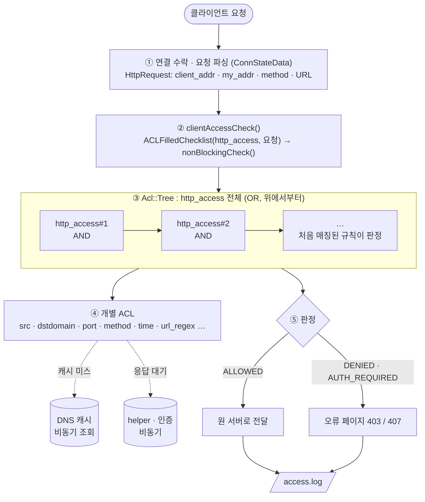
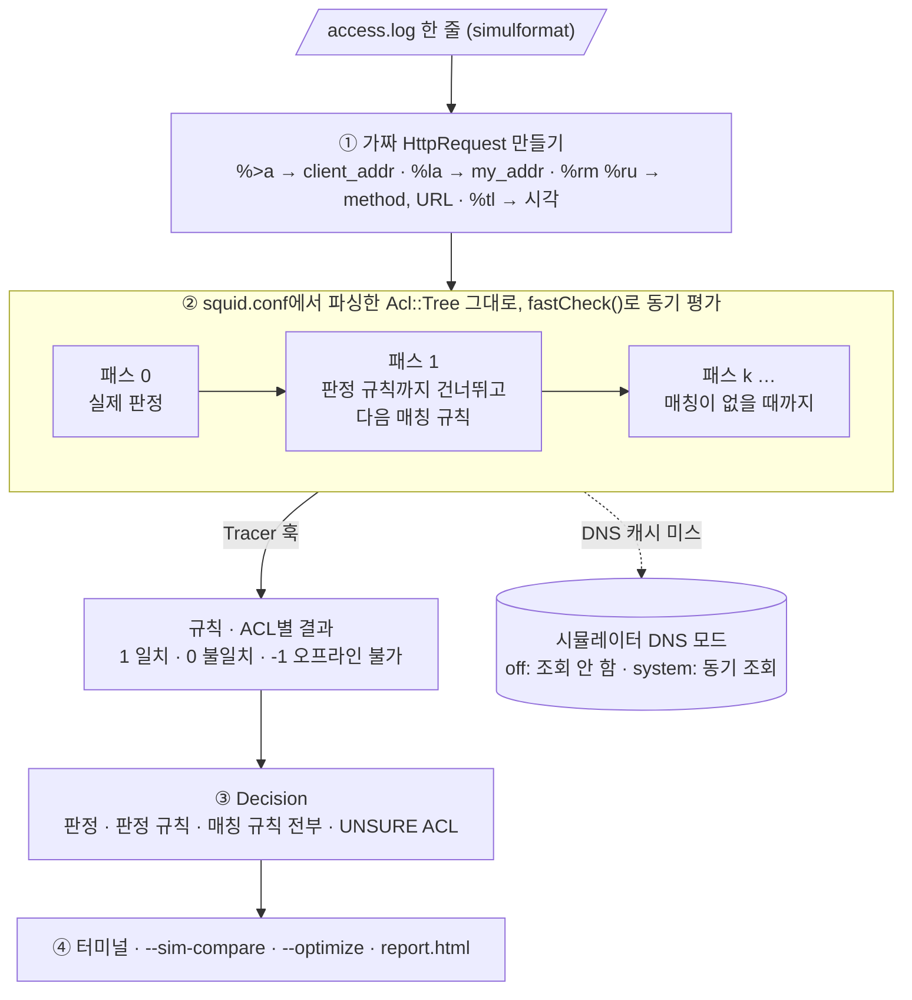

# squid-simulator

**squid.conf와 access.log를 넣으면, 요청마다 어떤 `http_access` 규칙이 허용·차단했는지 보여주는 오프라인 시뮬레이터입니다.**
Squid 소스에 패치로 붙어서, 판정은 Squid 자신의 설정 파서와 ACL 엔진이 그대로 내립니다.
소켓을 열거나 트래픽을 보내지 않으므로, 운영 중인 squid 옆에서 실행해도 됩니다.

| 기능 | 옵션 | 알 수 있는 것 |
|---|---|---|
| 요청별 판정 | `--simulate access.log` | 판정한 규칙, 그 요청에 매칭되는 다른 규칙 전부, 그 규칙이 없었다면의 결과, 실제 로그와의 일치 여부 |
| 설정 비교 | `--sim-compare new.conf` | 새 squid.conf로 바꾸면 판정이나 판정 규칙이 달라지는 요청 |
| 최적화 | `--optimize` | 쓰이지 않는 ACL, 이미 포함된 값, 도달할 수 없거나 중복된 규칙, 내장 ACL 재정의 |
| 리포트 | `--report out.html` | 위 결과 전체를 담은 HTML 한 파일 (검색·필터, 규칙별 평가 과정) |

## 브랜치

Squid 내부 API는 메이저 버전마다 달라서, 배포판의 squid 버전마다 브랜치를 나눕니다.

| 브랜치 | 대상 OS | squid | 검증 |
|---|---|---|---|
| `main` | Ubuntu 20.04 LTS | 4.10 | Ubuntu 20.04.6에서 빌드·`make check` 94 PASS·기능 테스트 28개·배포판 squid 비교 통과 |
| [`ubuntu-26.04-squid-7.7`](https://github.com/hyeonsa-claude/squid-simulator/tree/ubuntu-26.04-squid-7.7) | Ubuntu 26.04 LTS | 7.7 | Ubuntu 26.04.1에서 빌드·`make check` 103 PASS·기능 테스트 32개·배포판 squid 비교 통과 |

## 빠른 시작

### 1. 로그 형식 준비

운영 squid.conf에 `simulformat` 형식을 정의하고 access.log에 적용합니다.
시뮬레이터는 필드를 위치로 읽으므로 이름은 바꿔도 되지만, 필드 순서는 그대로여야 합니다.

```
logformat simulformat %tl %la %>a  "%rm %ru HTTP/%rv" %>Hs %<st %Ss:%Sh
access_log daemon:/var/log/squid/access.log simulformat
```

### 2. 빌드

```bash
git clone -b ubuntu-26.04-squid-7.7 https://github.com/hyeonsa-claude/squid-simulator.git
cd squid-simulator
scripts/build.sh --deps        # 빌드 패키지 설치(sudo) → 공식 소스 다운로드·SHA-256 확인 → Ubuntu 패치 4개 → 시뮬레이터 패치 → 빌드
```

패치된 바이너리는 `build/squid-7.7/src/squid`입니다. `make install`은 하지 않으며, 시스템의 squid는 건드리지 않습니다.
설치된 squid와 비교까지 한 번에 검증하려면 `scripts/verify-target.sh`를 실행합니다.

### 3. 실행

```bash
B=build/squid-7.7/src/squid
$B -f /etc/squid/squid.conf --simulate /var/log/squid/access.log            # 요청별 판정
$B -f /etc/squid/squid.conf --simulate access.log --sim-compare new.conf    # 설정 비교
$B -f /etc/squid/squid.conf --optimize                                      # 최적화 항목
$B -f /etc/squid/squid.conf --simulate access.log --sim-compare new.conf \
   --optimize --report report.html                                          # 전체 리포트
```

## 출력 예시

아래는 저장소의 테스트 설정·로그(`tests/`)로 실제 실행한 결과입니다.

**요청별 판정** (`--simulate`, `--sim-trace`를 붙이면 규칙별 평가 과정까지 표시)

```text
      4  DENY   http_access#3     10.0.0.5  GET http://x.ads.example.com/a.js  (log TCP_DENIED/403: same)
           decided by: http_access deny blocked
           matching:   #3 deny > #5 allow > #7 allow > #10 deny > #11 allow > #12 allow   | without #3: ALLOW by http_access#5
             #1    no     !Safe_ports=no   [http_access deny !Safe_ports]
             #2    no     CONNECT=no   [http_access deny CONNECT !SSL_ports]
             #3    MATCH  blocked=yes   [http_access deny blocked]
```

- `decided by`: 판정한 규칙(squid.conf 원문)
- `matching`: 이 요청에 매칭되는 모든 규칙. 차단됐다면 뒤쪽 `allow`가 "막히지 않았다면 허용했을 규칙"
- `without #3`: 판정 규칙을 지웠을 때의 결과
- `(log …: same)`: 실제 로그의 결과 코드와 비교. `same`, `DIFF`, `UNSURE`(로그만으로 판정할 수 없는 ACL 포함)

**설정 비교** (`--sim-compare`)

```text
      9  ALLOW -> DENY   VERDICT  10.0.0.5  GET http://www.facebook.com/
           current: #5       http_access allow localnet
           new:     #4       http_access deny social
```

**최적화** (`--optimize`)

```text
  HIGH    unreachable rule             http_access#12
          every request it matches is decided first by http_access#3 [http_access deny blocked] with the opposite action
          at:  http_access allow blocked localnet
          fix: move it above http_access#3 or delete it
  LOW     covered by a wider entry     localnet
          '10.1.0.0/16' is already covered by '10.0.0.0/8'
          at:  tests/squid.conf:11  acl localnet src 10.1.0.0/16
          fix: delete the narrower entry
```

## Squid는 `http_access`를 어떻게 판정하나

운영 중인 squid에서 요청 하나가 판정되는 경로입니다. 시뮬레이터가 그대로 쓰는 부분과 대신하는 부분을 이해하는 데 필요합니다.



판정 규칙의 핵심:

1. squid.conf의 `http_access` 줄들은 하나의 **OR 트리**(`Acl::Tree`)가 되고, 각 줄은 그 아래 **AND 노드**(`http_access#N`)가 됩니다.
   줄의 ACL 이름들이 AND 노드의 자식이며, `!acl`은 NOT 노드로 감쌉니다.
2. `OrNode::doMatch()`가 규칙을 위에서부터 차례로 평가하고, **처음 매칭된 규칙의 allow/deny가 판정**입니다.
   AND 노드는 첫 불일치에서 멈춥니다(단락 평가).
3. 어떤 규칙도 매칭되지 않으면 **마지막 규칙의 반대**가 판정입니다(implicit rule).
4. DNS나 helper가 필요한 ACL은 `goAsync()`로 검사를 멈췄다가, 답이 오면 이어서 평가합니다.

## 시뮬레이터는 이것을 어떻게 흉내 내나

설정 파싱까지는 운영 squid와 똑같이 진행한 뒤, 데몬화·포트 오픈·캐시 초기화 **전에** 시뮬레이터로 갈라집니다.
판정 로직은 바꾸지 않고, 입력을 로그로 바꾸고 관찰용 훅을 붙였습니다.



| 운영 squid | 시뮬레이터 |
|---|---|
| 소켓에서 요청을 읽고 파싱 | 로그 한 줄로 `HttpRequest::FromUrl()` 호출, 주소·포트·시각을 채움 |
| `nonBlockingCheck()`: DNS·helper 응답을 기다림 | `fastCheck()`: 기다리지 않음. 기다려야 하는 ACL은 `UNSURE`로 표시 |
| 현재 시각으로 `acl time` 평가 | 로그의 `%tl` 시각과 UTC 오프셋으로 평가 |
| DNS 비동기 조회 | `hosts_file`만 사용(기본) 또는 OS 리졸버로 동기 조회(`--sim-dns system`) |
| 처음 매칭된 규칙에서 끝 | 같은 판정 뒤에, 앞 규칙을 건너뛰며 다시 평가해 매칭되는 규칙을 모두 찾음 |
| 전달하거나 오류 페이지 응답 | 판정과 규칙만 기록하고 다음 줄로 |

### 매칭되는 모든 규칙을 찾는 방법

Squid는 첫 매칭에서 멈추므로, 뒤에서 허용했을 규칙을 알려면 다시 평가해야 합니다.
`OrNode::doMatch()`는 규칙마다 `Acl::Tree::bannedAction()`에 "이 규칙을 건너뛸까"를 묻는데, 여기에 위치 조건 하나
(`SkipRulesThrough`)를 더했습니다. 위 예시의 4번 줄(`x.ads.example.com`)은 이렇게 평가됩니다.

| 패스 | 건너뛰는 규칙 | 매칭 | 의미 |
|---|---|---|---|
| 0 | 없음 | `#3 deny blocked` | 실제 판정 (운영 squid와 같은 평가) |
| 1 | #1 ~ #3 | `#5 allow localnet` | #3이 없었다면 허용 |
| 2 | #1 ~ #5 | `#7 allow localnet Safe_ports` | |
| … | … | `#10`, `#11`, `#12` | |
| 6 | #1 ~ #12 | 없음 | 종료 |

승자 앞의 규칙은 이미 불일치였으므로 "승자까지 건너뛰기"는 "승자 다음부터 계속"과 같습니다. 판정에 쓰이는 것은 패스 0뿐이고,
`UNSURE` 여부도 패스 0에서 실제로 평가된 ACL만으로 정합니다.

### 수정한 Squid 소스

| 위치 | 하는 일 | 옵션 없이 실행할 때 |
|---|---|---|
| `src/AclSimulator.cci` (신규) | 로그 파싱, 다중 패스 평가, 비교, 최적화, 출력. `main.cc`가 포함 | 실행 안 됨 |
| `src/main.cc` | 옵션 7개, 설정 파싱 직후 `AclSimulator::Run()` | 영향 없음 |
| `src/acl/Checklist.{h,cc}` | `Tracer` 훅 (`matchChild()`, `goAsync()`), `SkipRulesThrough` | 꺼져 있음 |
| `src/acl/Tree.cc` | `bannedAction()`의 위치 조건 | 꺼져 있음 |
| `src/acl/{Acl,InnerNode,RegexData}.cc`, `src/acl/SplayInserter.h` | Squid가 이미 내던 중복·포함·병합 경고와 ACL 참조를 기록 (`--optimize`용) | 기록 안 함 |
| `src/ipcache.cc`, `src/fqdncache.cc` | DNS 캐시 미스 시 조회 생략 또는 동기 조회 | 기존 비동기 조회 |
| `src/cache_cf.cc`, `src/globals.h` | 설정이 가리키는 파일(예: `mime.conf`)이 없어도 `-k parse`처럼 계속 진행 | 기존 동작 |
| `src/external_acl.cc` | helper가 없을 때의 NULL 역참조 방지 | 운영 중엔 해당 없음 |

자세한 설명은 [docs/DESIGN.md](docs/DESIGN.md)에, squid 4.10에서 7.7로 바뀐 API와 훅 위치는 [docs/PORTING-7.7.md](docs/PORTING-7.7.md)에 있습니다.

이 브랜치는 Ubuntu 26.04 패키지와 같은 squid를 만들기 위해 업스트림 7.7 소스(Ubuntu의 orig tarball과 동일)에 Ubuntu 자체 패치 4개(기본 설정과 `internal.cc` 수정)를 먼저 적용합니다. squid 7부터는 `CONNECT`도 내장 ACL이라, squid.conf에서 다시 선언하면 `--optimize`가 `built-in ACL redefined`로 알려줍니다.

## 정확도와 한계

로그에 있는 정보만 쓰는 ACL(`src`, `dstdomain`, `url_regex`, `port`, `method`, `time`, `localip` 등)은 운영 squid와 같은 엔진으로
판정합니다. 로그에 없는 정보가 필요한 ACL은 결과를 추측하지 않고 `UNSURE`로 표시하며, 로그와 비교하지 않습니다.

| 종류 | ACL | 표시 |
|---|---|---|
| 요청 헤더 | `browser`, `referer_regex`, `req_header` | UNSURE |
| 인증 | `proxy_auth`, `proxy_auth_regex`, `max_user_ip` | AUTH, UNSURE |
| helper·연결 상태 | `external`, `ident`, `maxconn`, `note` 등 | UNSURE |
| DNS | `dst`, `srcdomain`, IP URL의 `dstdomain` | `--sim-dns off`: UNSURE / `system`: 지금의 DNS 결과 |

- 대상은 `http_access`입니다. 로그의 `TCP_DENIED`가 `ssl_bump`, `miss_access` 등 다른 지시어에서 왔다면 `DIFF`로 나옵니다.
- 최적화의 도달 불가·중복 규칙 판단은 ACL **이름** 기준입니다. 서로 다른 ACL의 값이 겹치는 경우는 찾지 않습니다.

## 문서

- [docs/USAGE.md](docs/USAGE.md): 로그 준비, 옵션, 출력 읽는 법, 최적화 항목 전체
- [docs/DESIGN.md](docs/DESIGN.md): 구조, 핵심 메커니즘, 소스 수정 내역
- [docs/VERIFICATION.md](docs/VERIFICATION.md): Ubuntu 26.04 실기 검증 결과
- [docs/PORTING-7.7.md](docs/PORTING-7.7.md): squid 4.10 → 7.7 이식 내역

## 저장소 구성

```
patches/squid-7.7-acl-simulator.patch    Squid 소스에 적용하는 패치 (patch -p1)
scripts/target.env                       이 브랜치의 대상 OS, squid 버전, 체크섬, configure 옵션
scripts/build.sh                         다운로드 → SHA-256 확인 → 패치 → configure → make [--check]
scripts/test.sh                          tests/의 설정·로그로 기능 테스트
scripts/verify-target.sh                 대상 OS에서 전체 검증 (빌드 + make check + 기능 테스트 + 배포판 비교)
tests/                                   테스트용 squid.conf, 비교용 conf, access.log, squid 7 전용 최적화 설정, 기대 결과
docs/                                    문서
```

## 라이선스

패치는 Squid와 같은 GPLv2+입니다.
