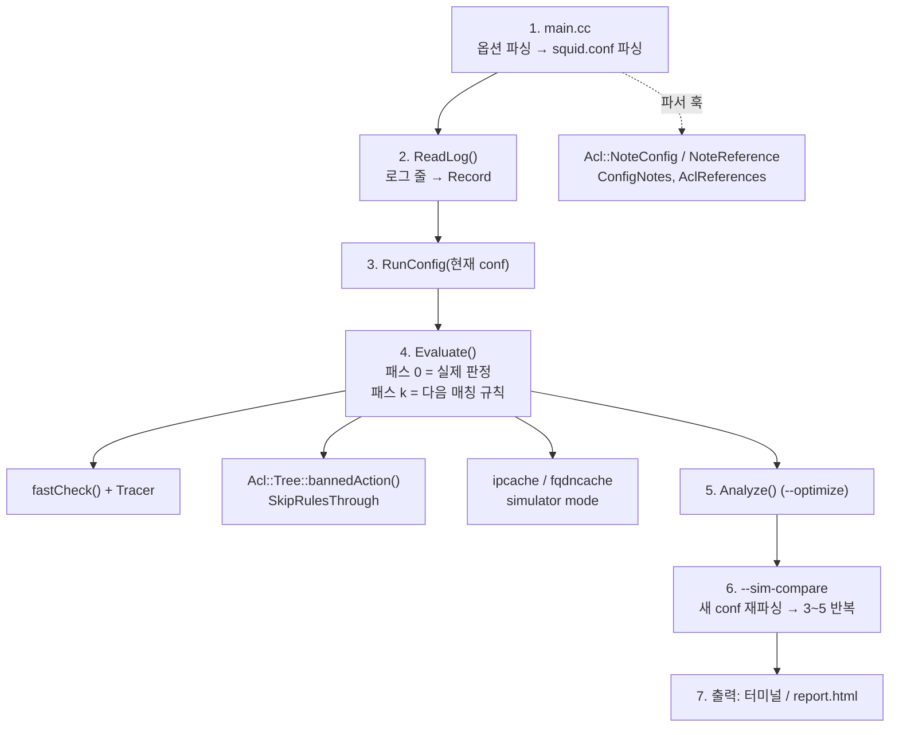
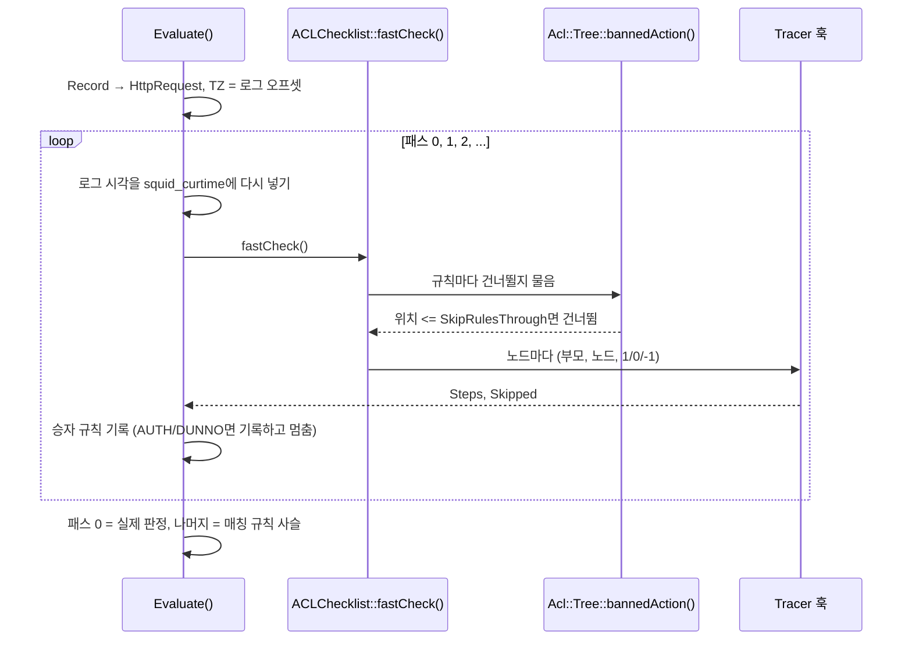
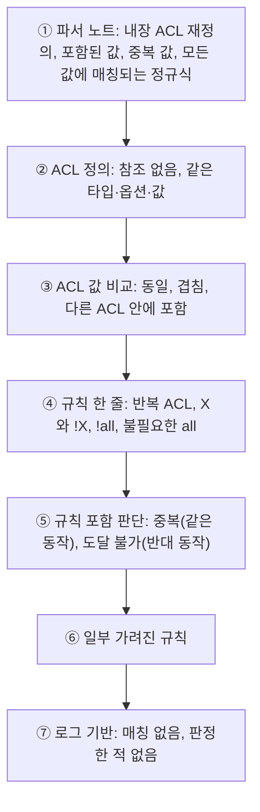
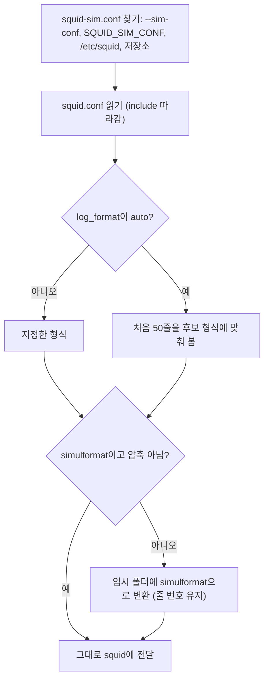
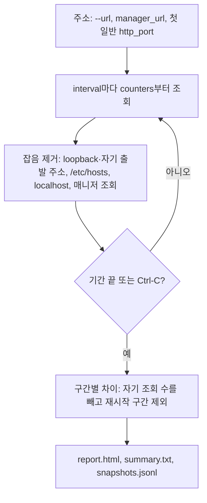

# Squid ACL 시뮬레이터 설계·검증 문서 (squid 4.10 / 7.7)

2026-10-31 · 이 문서는 프로젝트 설계·검증 문서(Claude 문서)를 그대로 옮긴 것입니다. 사용법은 [USAGE.md](USAGE.md), 그림 전체는 [OVERVIEW.md](OVERVIEW.md)에 있습니다.

## 개요와 신뢰도

판정은 Squid 원본의 ACL 엔진이 내리므로, 로그에 담긴 정보만 쓰는 ACL(`src`, `dstdomain`, `url_regex`, `port`, `method`, `time` 등)은 운영 squid와 같은 결과를 냅니다. **2026-10-31 두 테스트 서버에서 공식 소스로 처음부터 빌드한 전체 검증이 통과했습니다: Ubuntu 20.04(squid 4.10)는 `make check`와 기능 테스트 49개, Ubuntu 26.04(squid 7.7)는 `make check`와 기능 테스트 54개.** 두 서버의 실제 squid 로그를 재생한 결과 실제 로그와 판정이 다른 요청은 0건이었습니다. 남은 검증은 운영 squid.conf와 운영 로그로 돌려 보는 것입니다.

입력은 `logformat simulformat %tl %la %>a "%rm %ru HTTP/%rv" %>Hs %<st %Ss:%Sh` 형식의 access.log와 squid.conf입니다(`access_log … simulformat`으로 적용; 필드를 위치로 읽으므로 형식 이름은 바꿔도 됨). 출력은 요청별 판정과 판정 규칙, 매칭되는 모든 규칙, 두 설정의 차이, 최적화 항목, HTML 리포트입니다. 저장소 README에 Squid 내부 판정 구조와 시뮬레이션 방식을 그린 다이어그램이 있습니다.

| 영역 | 신뢰도 | 근거 |
| --- | --- | --- |
| 판정 (로그 정보만 쓰는 ACL) | 높음 | Squid의 `fastCheck()`가 그대로 판정. 테스트 로그 12줄의 판정·판정 규칙이 모두 기대값과 일치 |
| 판정 규칙과 매칭 규칙 목록 | 높음 | Squid가 붙인 `http_access#N` 이름과 `OrNode` 순회 순서를 그대로 사용. 테스트로 확인 |
| `--sim-compare` | 높음 | 테스트에서 기대한 3줄만 변경으로 보고. 두 번째 파싱은 reconfigure와 같은 경로 |
| 시간 ACL | 높음 | UTC 서버에서 로그의 +0900 시각으로 월요일·토요일 구분 확인 |
| DNS가 필요한 ACL | 중간\~낮음 | `--sim-dns off`는 UNSURE, `system`은 로그 시점이 아닌 현재 DNS 결과 |
| 헤더·인증·helper·연결 상태 ACL | 재현 불가 | 로그에 없는 데이터. UNSURE로 표시하고 로그 비교에서 제외 (테스트로 확인) |
| `--optimize` | 중간 | 테스트 설정의 8개 항목을 모두 찾음. 도달 불가·중복 규칙은 ACL 값 비교까지 써서 판단 (2차 재검토 후 ACL 값 비교 검사 10개 추가) |
| 빌드 (squid 4.10, Ubuntu 20.04) | 확인됨 | g++ 9.4, `-Wall -Wshadow -Werror`, `make check` 94개 PASS |
| squid 7.7 이식 (Ubuntu 26.04) | 확인됨 | 20.04에서 7.7을 7.7의 -Wextra -Werror로 빌드, make check 103개 PASS, 기능 테스트 28개 통과. Ubuntu 26.04.1 실기(g++ 15.2)에서도 make check 103 PASS, 기능 테스트 54개(2차 재검토 후), 배포판 squid 7.7과 -k parse 동일 |

## 저장소와 테스트 서버 검증

소스·스크립트·테스트·문서는 [hyeonsa-claude/squid-simulator](https://github.com/hyeonsa-claude/squid-simulator)에 있고, 배포판의 squid 버전마다 브랜치를 나눕니다.

| 브랜치 | 대상 | squid | 상태 |
| --- | --- | --- | --- |
| `main` | Ubuntu 20.04 LTS | 4.10 | 빌드·`make check`·기능 테스트 통과 |
| `ubuntu-26.04-squid-7.7` | Ubuntu 26.04 LTS | 7.7 (출시 시 7.2, 2026-10-22 업데이트로 7.7) | 이식 완료. 20.04에서 빌드·make check(103 PASS)·기능 테스트 통과, Ubuntu 26.04.1 실기 검증 통과(기능 테스트 54개) |

저장소의 `scripts/verify-target.sh`는 한 번에 다음을 실행합니다.

1. OS와 설치된 squid 버전이 브랜치 대상과 같은지 확인
2. 공식 tarball 다운로드와 SHA-256 확인, (26.04는 Ubuntu 자체 패치 4개 적용 후) 시뮬레이터 패치
3. `-Werror` 빌드와 Squid 단위 테스트 `make check`
4. 기능 테스트 `scripts/test.sh`: 테스트 설정·로그로 판정, 비교, 최적화, 리포트를 기대값과 대조
5. 배포판 squid와 패치한 squid의 `-k parse` 결과 비교

테스트 서버 실행에서 코드 검토로는 못 찾은 결함 3건이 나왔고 모두 고쳤습니다.

| 결함 | 수정 |
| --- | --- |
| 시뮬레이터를 돌리는 머신에 squid.conf가 가리키는 파일(예: `mime.conf`)이 없으면 FATAL로 종료 | `-k parse`처럼 경고만 하도록 `opt_simulate` 추가 (`globals.h`, `cache_cf.cc`) |
| 기록되는 debug 메시지가 `squid_curtime`을 현재 시각으로 되돌려 `acl time` 재생이 틀릴 수 있음 | 매 판정 직전에 로그 시각을 다시 설정 |
| `deny all` 뒤의 마지막 규칙에 "기본값을 정하므로 유지하라"는 잘못된 권고 | 앞에 무조건 규칙이 있으면 기본값이 쓰이지 않으므로 일반 중복으로 보고 |

## 운영 squid 영향 검증

**시뮬레이터는 실행 중인 squid에 영향을 주지 않습니다.** 두 테스트 서버(squid 4.10, 7.7)의 실행 중인 배포판 squid 옆에서, 실제 `/etc/squid/squid.conf`로 `--simulate`·`--optimize`를 일반 사용자와 root로 실행하며 `strace -f`로 시스템 호출을 기록했습니다.

| 확인 항목 | 결과 |
| --- | --- |
| squid 서비스 PID·시작 시각·재시작 횟수 | 변화 없음 |
| cache.log 크기, access.log 줄 수 | 변화 없음 (4.10 수정 후) |
| 시그널 전송 (`kill`) | 0 |
| TCP/UDP connect·listen | 0. `[::1]:0` IPv6 확인 소켓, 인터페이스 조회(netlink), 사용자 조회(nscd, systemd userdb)뿐 |
| 쓰기로 연 파일 | 0 (root 포함) |
| 공유 메모리, 자식 프로세스 | 0 |

검증 중 결함 하나를 찾아 고쳤습니다. squid 4.10을 root로 실행하면 설정 파싱 중 운영 `cache_log`를 열고 한 줄을 썼습니다. 이제 시뮬레이터 모드에서는 열지 않습니다(7.7은 원래 시뮬레이터 분기 뒤에 여는 구조). `scripts/verify-target.sh`가 시뮬레이터 단계 전후의 서비스 상태와 cache.log 크기를 비교해 매번 다시 확인합니다.

## 캐시 매니저 (`squid-sim -m`)

`scripts/squid-sim`은 모든 기능의 실행 진입점입니다. `-m`(`--manager`)이 없으면 인자를 패치한 squid로 넘기고, 있으면 `curl http://127.0.0.1:8090/squid-internal-mgr/ipcache`처럼 실행 중인 squid의 캐시 매니저를 읽습니다. squid 바이너리의 `-m`은 이미 다른 용도라, 이 기능은 스크립트에 두었습니다.

```bash
scripts/squid-sim -m                                      # 주요 페이지 요약
scripts/squid-sim -m --page ipcache --raw                 # 원문 그대로
scripts/squid-sim -m --url http://127.0.0.1:8090 --report 60m   # 60분 기록 → report.html, summary.txt
```

| 제외 대상 | 기준 |
| --- | --- |
| 클라이언트 | 127.0.0.0/8, `::1` |
| DNS | `/etc/hosts` 고정 항목(`H`), `localhost`·`ip6-*`, IP 리터럴 |
| 진행 중 요청 | `/squid-internal-mgr/` 조회 자신 |
| 요청 수 | 스크립트가 보낸 매니저 요청 수와 전송량을 구간마다 뺌 |

두 서버에서 3분 동안 로컬 요청 40개와 상대 서버 요청 32개를 보내며 기록했고, 리포트는 두 버전 모두 **요청 72개, 클라이언트 1개(TCP\_DENIED 32), DNS 12개 중 실패 8개**로 정확했습니다. 상태를 바꾸는 페이지(`shutdown`, `reconfigure` 등)는 거부하고, 매니저 조회는 squid access.log에 127.0.0.1 요청으로 남습니다(`access_log … !manager`로 뺄 수 있음). 자세한 내용은 저장소의 `docs/MANAGER.md`에 있습니다.

## 로그 형식과 squid-sim.conf

로그 형식은 사이트마다 다르므로, 형식은 운영 squid.conf가 아니라 시뮬레이터 전용 설정 파일 `squid-sim.conf`에서 관리합니다. squid 바이너리는 `simulformat` 한 가지만 읽고, `scripts/squid-sim`이 형식을 판별해 `simulformat`으로 바꾼 사본을 넘깁니다. 원본 로그는 읽기만 하고, 사본은 개인 임시 폴더에 두었다가 끝나면 지웁니다.

| 지시어 | 기본값 | 뜻 |
| --- | --- | --- |
| `squid_conf` | `/etc/squid/squid.conf` | 시뮬레이션할 squid.conf |
| `access_log` | `auto` | 재생할 로그. squid.conf의 첫 파일 `access_log`, 그 줄이 없으면 squid 기본값 `/var/log/squid/access.log` |
| `log_format`, `logformat` | `auto` | 형식 이름, 또는 squid 문법의 형식 정의(squid.conf 줄을 그대로 복사) |
| `local_ip` | `auto` | 형식에 `%la`가 없을 때의 프록시 주소 |
| `log_timezone` | `local` | `%ts`·`%tg`(UTC)를 현지 시각으로 바꿀 오프셋 |
| `sim_port`, `sim_dns`, `manager_url`, `manager_password_env` | `auto` | 명령행 옵션의 기본값 |

- **판별:** 처음 50줄을 squid.conf가 쓰는 형식 → 설정 파일의 logformat → squid.conf의 logformat → 미리 정의된 형식(`squid`, `common`, `combined`, `referrer`, `simulformat`) 순으로 맞춰 보고, 가장 많이 맞는 것을 고릅니다.
- **시각:** `%tl`은 그대로 쓰고, `%tg`(squid는 타임존 없이 씀)와 `%ts`는 `log_timezone`으로 현지 시각을 만듭니다. `%{strftime}tl`처럼 형식을 지정한 시각은 그 형식대로 읽습니다.
- **그 밖:** gzip 로그, 표준 입력, squid.conf의 `include`, UTF-8이 아닌 바이트 보존, `%"ru` 이스케이프 해제.
- **검증:** 같은 요청을 `squid` 형식, 사용자 정의 형식(`%tg`), gzip, 표준 입력으로 재생해 simulformat 원본과 판정이 한 줄도 다르지 않음을 테스트로 고정했습니다. 두 테스트 서버의 실제 squid(기본 설정, `squid` 형식)는 설정 파일 없이 `sudo scripts/squid-sim`만으로 판별·재생됐고, 실제 로그와 다른 판정은 0건이었습니다.

## ACL 값 비교와 규칙 포함 판단

`--optimize`는 ACL 이름뿐 아니라 squid가 덤프한 ACL 값을 같은 타입끼리 비교합니다.

| 타입 | 비교 방법 |
| --- | --- |
| `src`, `dst`, `localip` | IPv4/IPv6 주소 범위(128비트, 병합 후 이분 탐색) |
| `port`, `localport` | 포트 범위 |
| `dstdomain`, `srcdomain` | `.example.com` = 그 도메인과 모든 하위 도메인(접미사 조회) |
| `method`, `proto`, `myportname` | 값 집합 |

뒤 규칙에 매칭되는 모든 요청이 앞 규칙에도 매칭되면 뒤 규칙은 판정할 기회가 없습니다. 앞 규칙의 조건 하나하나가 뒤 규칙의 어떤 조건으로 보장되는지 봅니다.

| 앞 규칙 조건 | 뒤 규칙 조건 | 보장되는 경우 | 예 |
| --- | --- | --- | --- |
| `A` | `B` | `B`의 값이 모두 `A`에 있음 | `deny news`(.news.example) 뒤의 `allow www_news` |
| `!A` | `!B` | `A`의 값이 모두 `B`에 있음 | `deny !office` 뒤의 `deny !localnet` |
| `!A` | `B` | 공통 값이 없음 (`dst`·`srcdomain`, IP 값이 있는 `dstdomain`은 제외) | `deny !web_ports` 뒤의 `allow odd_port`(9000) |

새 항목은 `overlapping ACLs`(공유 값 예시 포함), 표기만 다른 `identical ACLs`, `ACL inside another ACL`(INFO, 한 ACL 안에 6개 이상이면 한 줄로 묶음), `partly shadowed rule`입니다. 5만 개짜리 도메인 목록 두 개와 `src` ACL 300개를 비교해도 약 2.5초이고, 기본 Ubuntu squid.conf에서 새로 나오는 것은 `SSL_ports`가 `Safe_ports` 안에 있다는 INFO 1건입니다.

## 코드 주석 규칙

저장소의 코드(시뮬레이터 C++, squid 소스에 더한 부분, `scripts/squid-sim`, 셸 스크립트)는 인라인 주석 없이, 함수·클래스·전역마다 아래 형식의 기능 주석 하나로 설명합니다.

```text
########
# 함수명 -> 출력
# 어떻게 동작하는지
########
```

| 언어 | 위치 |
| --- | --- |
| C++ | 정의 바로 위 `/* ... */` 안. `#`으로 시작하는 줄은 C++에서 전처리 지시어라 블록 주석으로 감쌌습니다. 시뮬레이터에 4.10은 92개, 7.7은 93개 |
| Python | 함수·클래스·메서드의 docstring (`help()`로도 보임) |
| bash | 함수 바로 위와 스크립트 맨 위. 각 단계를 함수로 나눴습니다 |

squid 원본 코드의 주석은 그대로 두었습니다. `globals.h`의 `/* 0 */`은 주석이 아니라 `mk-globals-c.awk`가 읽는 초기값이라 남겼습니다.

## 전체 구조와 실행 흐름

시뮬레이터는 별도 프로그램이 아니라 squid 바이너리 안의 다른 실행 경로입니다. 설정 파싱까지는 운영 squid와 똑같이 진행하고, 데몬화·포트 오픈·캐시 초기화 전에 `AclSimulator::Run()`으로 갈라져 끝납니다.



판정은 오른쪽 Squid 엔진이 내리고, 왼쪽 코드는 요청을 넣고 훅으로 결과를 모으기만 합니다. 점선은 `--sim-compare`가 같은 프로세스에서 새 conf를 다시 파싱하는 경로입니다.

| 단계 | 함수 | 입력 → 출력 |
| --- | --- | --- |
| 1 | `main.cc` `SquidMain()` | 명령행 → 파싱된 `Config` (`Config.accessList.http`, `Config.aclList`) |
| 2 | `ReadLog()`, `ParseLine()` | 로그 줄 → `Record` (파싱 실패 줄도 SKIP으로 보관) |
| 3 | `RunConfig()` | `Record` 배열 → `ConfigRun` (규칙 목록, `Decision` 배열, 집계) |
| 4 | `Evaluate()` | `Record` → `Decision` (판정, 판정 규칙, 매칭 규칙 목록, UNSURE ACL, trace, 로그 비교) |
| 5 | `Analyze()` | 파서 노트 + 규칙 목록 + 집계 → `Finding` 목록 |
| 6 | `parseConfigFile(new)` + 3\~5 | 새 conf로 두 번째 `ConfigRun` |
| 7 | `PrintDecision()`, `PrintChanges()`, `PrintRunSummary()`, `PrintFindings()`, `WriteReport()` | `ConfigRun` 1\~2개 → 터미널, HTML |

### 기능별 흐름도

저장소의 `docs/OVERVIEW.md`에 9개 그림을 모아 두었습니다. 여기에는 핵심 네 가지를 옮깁니다.

**요청 하나의 판정.** Squid는 첫 매칭 규칙에서 멈추므로, 뒤에서 매칭될 규칙을 찾으려고 같은 요청을 여러 번 평가합니다.



**최적화.**



**로그 형식 판별과 변환.**



**캐시 매니저 기록.**



## 소스 수정 내역

패치는 4.10에서 18개, 7.7에서 17개 파일을 바꾸며, 새 코드 대부분(4.10은 2,604줄, 7.7은 2,629줄, 기능 주석 포함)은 새 파일 `src/AclSimulator.cci` 하나에 들어 있습니다. 기존 파일에는 훅과 기록 지점만 추가했습니다. 새 코드를 `main.cc`가 `#include` 하는 `.cci` 파일로 둔 이유는 두 가지입니다. `Makefile.am`/`Makefile.in`을 고치지 않고 `./configure && make`로 빌드하기 위해서, 그리고 `make check`의 testHeaders가 `src/*.h`를 하나씩 `-Werror`로 컴파일하므로 `.h`를 피하기 위해서입니다 (Squid의 `cf_parser.cci`와 같은 관례). 아래 표의 줄 수는 4.10 기준입니다.

| 파일 | 추가/삭제 줄 | 바꾼 내용 | 옵션 없이 실행할 때 영향 |
| --- | --- | --- | --- |
| `src/AclSimulator.cci` (신규) | +2604 | 로그 파싱, 재생 엔진, 다중 패스 규칙 탐색, 비교, `--optimize` 분석, 터미널 출력, HTML 리포트 | 없음 (옵션이 있을 때만 실행) |
| `src/main.cc` | +80 / −2 | 긴 옵션 7개, 도움말, `.cci` 포함, 설정 파싱 직후 `AclSimulator::Run()` 호출 후 종료, `--simulate`/`--optimize`에서만 파싱 노트 켜기 | 없음 |
| `src/acl/Checklist.h`, `.cc` | +24, +7 | 정적 훅 `ACLChecklist::Tracer`와 `ACLChecklist::SkipRulesThrough`. `matchChild()`와 `goAsync()`에서 훅 호출 | 없음 (`Tracer`는 nullptr, `SkipRulesThrough`는 −1) |
| `src/acl/Tree.cc` | +3 / −1 | `Acl::Tree::bannedAction()`이 `SkipRulesThrough` 이하 위치의 규칙을 건너뜀 | 없음 (−1이면 기존 분기 그대로) |
| `src/acl/Acl.h`, `Acl.cc` | +80, +121 | `CollectConfigNotes` 스위치, 파싱 노트(`ConfigNotes`, ACL 타입 포함), 참조 횟수(`AclReferences`, 소문자 키), 내장 ACL 이름, `NoteConfig()`, `SeenValue()`, `NoteReference()`, `ClearConfigNotes()` | 없음 (스위치가 꺼져 있으면 기록하지 않음) |
| `src/acl/InnerNode.cc` | +1 | 규칙·ACL이 ACL 이름을 풀 때 `NoteReference()` | 없음 |
| `src/acl/DomainData.cc`, `Ip.cc`, `RegexData.cc` | +3, +5, +6 | Squid가 이미 내던 포함·중복 경고, 전체 매칭 정규식을 노트로도 기록 (`-i`/`+i` 플래그는 제외) | 없음 |
| `src/external_acl.cc` | +3 | helper·캐시가 초기화되지 않았으면 `ACCESS_DUNNO` 반환 (시뮬레이터에서 NULL 역참조 방지) | 없음 (운영 중에는 항상 초기화됨) |
| `src/ipcache.h`, `.cc` | +9, +69 | `ipcache_simulator_mode`: 0 = 기존 비동기 DNS, 1 = 조회 생략, 2 = `getaddrinfo()` 동기 조회. 성공은 고정 엔트리, 실패는 음성 캐시 | 없음 (기본 0) |
| `src/fqdncache.h`, `.cc` | +8, +46 | `fqdncache_simulator_mode`: 역방향 조회를 같은 방식으로 (`getnameinfo()`) | 없음 (기본 0) |
| `src/globals.h, src/cache_cf.cc` | +1, +3 / −2 | opt\_simulate: 설정이 가리키는 파일(mime.conf 등)이 없어도 경고만 하고, 시뮬레이터에서는 cache\_log를 열지 않음 | 없음 (기본 0) |

기존 함수의 시그니처와 동작은 바꾸지 않았습니다. 바뀐 것은 정적 변수가 기본값이 아닐 때만 타는 분기, 스위치가 켜졌을 때만 하는 기록, 그리고 운영 중에는 거짓이 될 수 없는 `external_acl.cc`의 NULL 검사 하나뿐입니다.

## 핵심 메커니즘

판정은 운영 squid와 같은 `ACLFilledChecklist::fastCheck()`가 내립니다. 시뮬레이터는 요청을 만들어 넣고, 훅으로 결과를 관찰하기만 합니다.

### 1. 가짜 요청 만들기

로그 한 줄에서 다음을 채워 `HttpRequest`와 `ACLFilledChecklist`를 만듭니다.

| 로그 필드 | 넣는 곳 | 영향받는 ACL |
| --- | --- | --- |
| `%>a` | `request->client_addr` (및 `indirect_client_addr`) | `src`, `srcdomain` |
| `%la` + 포트 | `request->my_addr` (포트 = `--sim-port` 또는 첫 `http_port`) | `localip`(`myip`), `localport` |
| 첫 `http_port`의 name | `request->myportname` | `myportname` |
| `%rm`, `%ru` | `HttpRequest::FromUrl()` (CONNECT이면 `host:port` 파싱) | `method`, `dstdomain`, `dst`, `port`, `proto`, `url_regex`, `urlpath_regex`, `ssl::server_name` |
| `%rv` | `request->http_ver` | (버전 기반 ACL은 거의 없음) |
| `%tl` | `squid_curtime`, `current_time`, 프로세스 `TZ` | `time` |
| `%Ss`, `%>Hs` | 입력에 쓰지 않고 결과 비교에만 사용 | — |

### 2. 노드별 관찰: `ACLChecklist::Tracer`

Squid는 `http_access` 줄들을 OR 트리(`Acl::Tree`) 아래 줄마다 AND 노드(`http_access#N`)로 만들고, 자식을 평가할 때마다 `matchChild()`를 거칩니다. 여기서 비동기 대기 중이 아닌 결과를 `Tracer(parent, child, 1|0)`로 넘기므로, 부모가 트리인 이벤트 = 규칙 단위 결과, 부모가 규칙인 이벤트 = ACL 단위 결과가 됩니다. AND 노드는 처음 불일치에서 멈추므로 trace도 Squid의 단락 평가 순서를 그대로 보여줍니다. `fastCheck()`에서는 비동기 조회가 금지되어 `goAsync()`가 false를 돌려주는데, 이때 `Tracer(…, -1)`을 보내 해당 ACL을 "오프라인 판정 불가"(`UNSURE`)로 표시합니다.

로그 형식에 없는 데이터를 보는 ACL 타입(`browser`, `req_header`, `proxy_auth`, `external`, `maxconn`, `note` 등 32종)은 결과가 나와도 같은 목록에 넣어 `UNSURE`로 표시합니다. 판정을 바꿀 수 있는 것은 패스 0에서 판정 규칙까지 평가된 ACL뿐이므로, `UNSURE`는 패스 0의 기록만으로 정합니다. AUTH·DUNNO 판정은 그 판정을 낸 ACL을 더해 항상 `UNSURE`입니다.

### 3. 매칭되는 모든 규칙 찾기: `SkipRulesThrough`

Squid는 첫 매칭에서 멈추므로, 뒤에서 허용했을 규칙을 알려면 다시 평가해야 합니다. 패스 0은 실제 판정이고, 패스 k는 `SkipRulesThrough` = 직전 승자의 위치로 두고 다시 `fastCheck()`합니다. `Acl::Tree::bannedAction()`은 이미 `OrNode::doMatch()`가 규칙마다 묻는 "이 규칙 건너뛸까" 지점이라, 여기에 위치 조건 하나만 더했습니다. 승자 이전 규칙은 어차피 불일치였으므로 "승자까지 건너뛰기"는 "승자 다음부터 계속"과 같습니다. 더 매칭되는 규칙이 없거나 AUTH 같은 예외 응답이 나오면 멈추며, 비용은 요청당 (매칭 규칙 수 + 1)번의 평가입니다.

### 4. 오프라인 DNS

`dst`, `srcdomain`, IP URL에 대한 `dstdomain`은 평소 비동기 DNS를 걸고 콜백을 기다립니다. 시뮬레이터는 이벤트 루프도 DNS 모듈도 시작하지 않으므로 `ipcache_gethostbyname()`과 `fqdncache_gethostbyaddr()`의 캐시 미스 분기를 바꿨습니다.

- `--sim-dns off`(기본): 조회하지 않고 NULL. `hosts_file` 항목은 `parseEtcHosts()`로 미리 캐시에 들어 있어 동작합니다. 나머지는 `UNSURE`.
- `--sim-dns system`: `getaddrinfo()`/`getnameinfo()`로 동기 조회 후 고정(잠긴) 엔트리로 캐시합니다. 동시에 체크리스트에 "조회 완료" 표시(`destinationIpLookedUp`, `markDestinationDomainChecked()`)를 미리 해 두어, 조회 실패는 운영 squid가 조회 실패 뒤 하는 것처럼 불일치(`none`)로 처리됩니다.

### 5. 시간

`%tl`(예: `31/Oct/2026:09:59:01 +0900`)을 UTC epoch으로 바꿔 `squid_curtime`에 넣고, 프로세스 `TZ`를 로그의 오프셋(`SIM-09:00`)으로 맞춥니다. `acl time`은 `localtime(squid_curtime)`을 쓰므로 시뮬레이터를 돌리는 서버의 타임존과 관계없이 프록시가 본 현지 시각으로 판정합니다.

### 6. 파서 노트

`--optimize`의 포함/중복/내장 재정의 항목은 별도 파서를 만들지 않고, Squid 파서가 이미 cache.log에 경고를 내는 자리에서 `Acl::NoteConfig()`로 파일:줄번호와 함께 기록합니다. 그래서 `"/etc/squid/blocked.txt"`처럼 파일에서 읽은 값도 나오며, `ParsingAcl`이 설정된 파싱 구간에서만 기록되므로 같은 비교 함수가 매칭 때 불려도 기록되지 않습니다. 참조 횟수는 규칙과 `any-of`/`all-of`가 ACL 이름을 풀 때(`InnerNode::lineParse()`) 계산합니다.

이 기록은 `Acl::CollectConfigNotes`가 켜져 있을 때만 하며, `--simulate`나 `--optimize` 옵션이 설정 파싱 전에 켭니다. 운영 squid는 스위치가 꺼져 있어 reconfigure를 반복해도 메모리가 늘지 않습니다. Squid 기본 설정("Default Configuration") 파싱 중의 노트는 버리고, 참조 횟수는 Squid처럼 대소문자를 구분하지 않습니다.

## 기능별 사용법과 출력 해석

모든 기능은 빌드한 `src/squid` 바이너리 하나의 옵션입니다. `-f`로 준 squid.conf가 "현재" 설정입니다.

| 옵션 | 인자 | 하는 일 |
| --- | --- | --- |
| `--simulate` | 로그 파일 또는 `-` | 로그 전체를 `http_access`에 재생 |
| `--sim-compare` | 새 squid.conf 경로 | 같은 로그를 새 설정으로도 재생해 달라진 요청만 출력 |
| `--report` | HTML 출력 경로 | 단일 HTML 리포트 작성 (요청별 터미널 출력은 생략) |
| `--optimize` | 없음 | 설정 정적 분석, `--simulate`가 있으면 로그 기반 분석 추가 |
| `--sim-trace` | 없음 | 요청마다 규칙·ACL별 평가 과정 출력 |
| `--sim-dns` | `off` 또는 `system` | DNS가 필요한 ACL 처리 방식 |
| `--sim-port` | 포트 번호 | 가짜 요청의 로컬 포트 |

### 요청별 판정 (`--simulate`)

```bash
./squid -f /etc/squid/squid.conf --simulate /var/log/squid/access.log
```

```text
     12  DENY   http_access#5     10.0.0.5  GET http://ads.example.com/x.js  (log TCP_DENIED/403: same)
           decided by: http_access deny blocked_sites
           matching:   #5 deny > #9 allow   | without #5: ALLOW by http_access#9
```

- `decided by`: 판정한 규칙의 squid.conf 원문. 어떤 규칙도 매칭되지 않으면 `implicit`(마지막 규칙의 반대 동작).
- `matching`: 매칭되는 모든 규칙을 순서대로. DENY라면 뒤쪽의 `allow`가 "막히지 않았다면 허용했을 규칙"입니다.
- `without #5`: 판정 규칙을 지웠을 때의 결과.
- `(log …)`: 로그의 `%Ss`와 비교. `same`, `DIFF`, `UNSURE`(오프라인 판정 불가 ACL 포함), `n/a`(`NONE`처럼 비교 불가).

끝에 규칙별 `decided`(판정 수)와 `also-matched`(매칭됐지만 앞 규칙이 먼저 판정한 수), `never decides` 표시가 요약됩니다.

### 설정 비교 (`--sim-compare`)

```bash
./squid -f /etc/squid/squid.conf --simulate access.log --sim-compare /tmp/squid.new.conf
```

```text
    812  ALLOW -> DENY   VERDICT  10.0.3.7  CONNECT api.example.com:443
           current: #6       http_access allow localnet
           new:     #4       http_access deny CONNECT !SSL_ports
```

`VERDICT`는 허용/차단이 바뀐 경우, `rule`은 판정은 같고 판정 규칙만 바뀐 경우입니다. 규칙을 끼워 넣으면 번호가 밀리므로 비교는 규칙 원문 기준입니다. 마지막에 `ALLOW #6 -> DENY #4` 같은 전이 유형별 건수가 나옵니다.

### 전체 리포트 (`--report`)

```bash
./squid -f /etc/squid/squid.conf --simulate access.log --sim-compare /tmp/squid.new.conf --optimize --report report.html
```

외부 파일 없이 열리는 HTML 한 파일입니다(라이트/다크). 구성 순서는 다음과 같습니다.

1. 요약 카드: 전체, 허용, 차단, AUTH/기타, 판정 불가, 로그와 불일치, 건너뜈 줄. 비교 시 판정 변경, 새로 차단, 새로 허용, 규칙만 변경.
2. 최적화 결과 (`--optimize` 시).
3. 변경 내역: 현재 판정·규칙 → 새 판정·규칙, 건수, 예시 요청.
4. 규칙 표: 규칙별 판정 수 막대, `also matched`, `never decides`, 한쪽 설정에만 있는 규칙(`only here`).
5. 차단 분석: 차단 규칙별 상위 목적지 10개, 상위 클라이언트 10개, 그 요청을 허용했을 다음 allow 규칙.
6. 요청 표: (클라이언트, 메서드, 목적지, 결과)별 묶음, 검색·판정 필터·`changed only`, 규칙을 클릭하면 trace. 표당 최대 5,000행.
7. 시뮬레이션 vs access.log 불일치.

### 최적화 (`--optimize`)

```bash
./squid -f /etc/squid/squid.conf --optimize
```

| 심각도 | 항목 | 판단 근거 |
| --- | --- | --- |
| HIGH | `unreachable rule` | 앞 규칙의 ACL 집합이 이 규칙 ACL 집합의 부분집합이고 동작이 반대 |
| HIGH | `rule never matches` | `X`와 `!X`를 함께 요구, 또는 `!all` |
| MEDIUM | `redundant rule` | 위와 같되 동작이 같음 (예: `allow all` 뒤 규칙) |
| MEDIUM | `built-in ACL redefined` | `all`, `manager`, `localhost`, `to_localhost`, `ssl::*` 재선언 |
| MEDIUM | `matches everything` | `.*`, `.`, `^` 정규식 |
| MEDIUM | `never decides in the log` | 로그에서 매칭은 됐지만 항상 앞 규칙이 판정 |
| LOW | `covered by a wider entry` | `.example.com`이 `www.example.com`을, `10.0.0.0/8`이 `10.1.0.0/16`을 포함 |
| LOW | `duplicate entry` | 같은 도메인·IP·정규식이 두 번 |
| LOW | `unused ACL` | 어떤 지시어나 ACL도 참조하지 않음 |
| LOW | `identical ACLs` | 타입과 값이 같은 다른 이름 |
| LOW | `repeated ACL in rule`, `redundant 'all'` | 한 규칙 안 반복, 다른 조건과 함께 쓴 `all` |
| LOW | `no logged request matches` | 로그의 어떤 요청에도 매칭되지 않음 |

## 재검증 결과

재검증에서 13건을 찾았고, 실제 사용을 막는 3건(빌드 실패, 크래시, 운영 메모리 증가)을 포함해 모두 수정했습니다. 그 뒤 두 테스트 서버에서 빌드와 실제 로그 재생을 확인했고, 2차 전체 재검토에서 결함 30건을 더 찾아 고쳤습니다(아래 "2차 전체 재검토").

### 검토 방법

- 독립 검토: 작성 과정을 모르는 별도 에이전트가 패치를 Squid 4.10 실제 헤더와 대조했습니다. 대상은 컴파일 오류(`-Wall -Wshadow -Werror`, C++11), 런타임 버그, 운영 동작 변화, `make check` 스텁 링크입니다.
- 사용한 Squid API(시그니처, const, 접근 수준, 네임스페이스)는 모두 헤더에서 확인됐고, `-Wshadow`·미사용 함수·부호 비교 경고는 본 빌드 기준으로 없었습니다.
- 수정 후 변경분은 제가 직접 다시 검토했습니다 (독립 검토를 한 번 더 돌리지는 않음).

### 발견 사항과 조치

| # | 심각도 | 문제 | 조치 |
| --- | --- | --- | --- |
| 1 | 빌드 실패 | `make check`의 testHeaders가 `AclSimulator.h`를 단독 컴파일하면 `Run()` 미사용 경고가 `-Werror`로 실패 | `AclSimulator.cci`로 이름 변경 |
| 2 | 크래시 | `external` ACL이 초기화되지 않은 helper·캐시(NULL)를 역참조 | `external_acl.cc`에 NULL 검사, DUNNO 반환 |
| 3 | 운영 영향 | 파싱 노트가 항상 기록되어 운영 squid가 reconfigure할 때마다 메모리 증가 | `CollectConfigNotes` 스위치, 시뮬레이터 옵션에서만 켬 |
| 4 | 논리 | 판정 뒤 규칙의 ACL까지 UNSURE로 잡아 확실한 판정도 로그 비교에서 빠짐 | UNSURE는 패스 0 기록만 사용 |
| 5 | 논리 | AUTH·DUNNO와 헤더 기반 ACL 결과가 로그와 비교되어 가짜 DIFF | AUTH·DUNNO와 로그에 없는 데이터를 보는 32개 타입을 UNSURE로 |
| 6 | 논리 | `browser`의 `.*`, `dst all`을 "모두 매칭"으로 보고 가짜 "도달 불가" 보고 | 보편 ACL은 `url_regex`/`urlpath_regex`의 `.*`와 `src all`만 |
| 7 | 경미 | `-i`/`+i` 플래그를 중복 정규식으로 보고 | 플래그 제외 |
| 8 | 성능 | `--sim-dns system`에서 실패한 조회를 패스마다 반복 | 실패 이름 음성 캐시 |
| 9 | 논리 | 마지막 규칙을 지울 때의 implicit 결과를 잘못 계산, 마지막 규칙 삭제 권고 | 지운 규칙을 빼고 계산, 기본값을 바꾸는 경우 "유지" 권고 |
| 10 | 경미 | AUTH로 끝난 규칙이 "판정" 집계에서 빠짐 | 판정 규칙을 직접 집계 |
| 11 | 경미 | `myportname`이 항상 첫 `http_port` | 포트가 같은 `http_port`를 찾음 |
| 12 | 경미 | ALE에 `adapted_request`가 없어 경고 출력 | 원 요청으로 채움 |
| 13 | 경미 | `toupper` 부호 문제, ACL 이름 대소문자, 기본 설정 노트, `ConfigParser.h` 간접 포함, `random` ACL, 동일 ACL 비교 시 옵션 무시 | 모두 수정 (`random`은 UNSURE, 동일 ACL 비교에 옵션 포함) |

### 남은 위험

- **운영 로그 대조:** 테스트 서버의 실제 로그(기본 설정)로는 실제 로그와 다른 판정이 0건이지만, 운영 squid.conf와 운영 로그로는 아직 돌려 보지 않았습니다. 첫 실행에서 `DIFF` 비율을 확인하는 것이 가장 빠른 검증입니다.
- **값으로 비교할 수 없는 ACL:** 정규식, `time`, 헤더·인증 계열은 이름이 같을 때만 같은 조건으로 봅니다.
- **일부 가려진 규칙:** `partly shadowed rule`은 "겹칠 수 있음"입니다. 뒤 규칙의 다른 조건이 겹치는 요청을 배제할 수도 있습니다.

### 2차 전체 재검토 (2026-10-31)

C++ 코드와 Python·셸 코드를 따로 다시 검토해 찾은 결함입니다. 모두 고쳤고, 4.10과 7.7 두 버전에서 시나리오로 확인한 뒤 공식 소스부터 다시 빌드한 전체 검증(`verify-target.sh`)이 두 서버에서 통과했습니다(20.04: `make check`와 기능 테스트 49개, 26.04: `make check`와 기능 테스트 54개).

| 영역 | 결함 | 고친 내용 |
| --- | --- | --- |
| 판정 | 뒤 패스에서 AUTH/DUNNO로 멈추면 매칭 사슬이 끊기고 "그 규칙이 없었다면"이 implicit으로 잘못 나옴. 그 아래 규칙이 "판정한 적 없음"으로 잘못 보고됨 | 멈춘 규칙을 예외 응답과 함께 사슬에 넣음 (`#1 deny > #2 auth`). 검사가 멈춘 판정이면 "알 수 없음" |
| 판정 | 이어 쓴 설정 줄은 마지막 물리 줄만 규칙 텍스트로 쓰여, 비교 모드에서 다른 규칙을 같은 규칙으로 볼 수 있음 | 규칙 텍스트를 `treeDump()` 결과(한 줄 전체)에서 가져옴 |
| 판정 | 시각을 읽지 못한 줄이 앞 줄의 시각으로 `acl time`을 평가 | 평가된 `time` ACL을 UNSURE로 |
| 비교 | 첫 설정의 `hosts_file` 항목이 두 번째 설정 재생에 남음, 목적지 호스트를 두 설정이 덮어씀 | hosts 항목을 비우고, 목적지는 판정마다 보관 |
| 최적화 | `urlpath_regex .*`를 모든 요청에 매칭된다고 봄 (CONNECT는 경로가 없음) | `url_regex`만 모든 요청으로 봄 |
| 최적화 | 마지막 규칙이 도달 불가면 "지워라"라고 권함 (지우면 기본 판정이 뒤집힘) | MEDIUM으로 낮추고 반대 동작의 `all` 규칙으로 바꾸라고 권함 |
| 최적화 | IP 값이 있는 `dstdomain`을 "공통 값 없음"으로 판단 (IP 호스트는 역방향 이름으로도 비교) | 그 판단을 하지 않음 |
| 최적화 | `acl ALL`처럼 대소문자만 다른 내장 ACL 재정의를 못 찾음 (4.10) | 정규화된 이름으로 비교 |
| 최적화 | 큰 주소 목록끼리 공통 값 계산이 O(n×m) | O(n+m) |
| 로그 형식 | squid의 `%tg`(타임존 없음)를 변환하지 못함. 테스트 로그에 타임존을 손으로 넣어 놓쳤음 | 타임존을 선택으로, `%{strftime}` 지원, 테스트 로그를 squid 출력 그대로로 |
| 로그 형식 | 표준 입력 로그의 앞 50줄을 형식 판별이 소비, squid.conf `include` 미지원, UTF-8이 아닌 바이트 손상 | 임시 파일로 받기, include 따라가기, 바이트 보존 |
| 실행 | `-f파일`, `--simul` 같은 표기를 squid와 다르게 해석, 신호 종료 시 종료 코드 오류와 임시 파일 잔류 | getopt처럼 정규화, 128+신호, 신호 전달 후 정리 |
| 매니저 | IP를 지정한 포트로 조회하면 자기 조회가 클라이언트로 집계 | 자기 출발 주소도 제외 |
| 매니저 | 조회하지 않은 페이지의 빈 구역, 첫 조회 실패·재시작 시 잘못된 증가분, 진행 중 요청의 클라이언트 오귀속, 비 HTTP 포트에서 중단 | 조회한 페이지만 표시, 스냅숏 사이 증가분과 가동 시간으로 재시작 감지, 연결마다 초기화, 오류로 기록 |
| 검증 | 테스트가 squid의 종료 코드를 보지 않음, `verify-target.sh`가 최적화 결과를 버리고 매니저는 헤더만 확인 | 종료 코드 검사, 매니저 해석 결과와 스냅숏 수 확인 |

## 한계와 운영 가이드

운영 squid와 같은 `./configure` 옵션으로 빌드해야 같은 ACL 타입과 기본값이 적용됩니다.

### 빌드 절차

1. 운영 서버에서 `squid -v`로 configure 옵션을 확인합니다.
2. 빌드 서버에서 4.10 소스를 풀고 패치를 적용합니다.
3. 같은 옵션으로 `./configure` 후 `make`합니다. `make install`은 필요 없고 `src/squid`를 그대로 씁니다.
4. 운영 설정으로 `--optimize`를 먼저 돌려 파싱과 출력을 확인한 뒤, 작은 로그 샘플로 `--simulate`를 확인합니다.

```bash
tar xzf squid-4.10.tar.gz && cd squid-4.10
patch -p1 < squid-4.10-acl-simulator.patch
./configure <squid -v에서 확인한 옵션>
make -j"$(nproc)"
```

### 오프라인에서 재현되지 않는 것

| 종류 | 해당 ACL | 시뮬레이터 표시 |
| --- | --- | --- |
| 로그에 없는 요청 헤더 | `browser`, `referer_regex`, `req_header`, `req_mime_type` | 헤더가 없으므로 불일치로 평가되고 UNSURE 표시 |
| 사용자 인증 | `proxy_auth`, `proxy_auth_regex`, `max_user_ip` | 자격증명 없음 → `AUTH`, UNSURE 표시 |
| 외부 helper·비동기 조회 | `external`, `ident`, `asn` | `UNSURE` |
| 연결 상태 | `maxconn` | 항상 불일치, UNSURE 표시 |
| DNS | `dst`, `srcdomain`, IP URL의 `dstdomain` | `off`: `UNSURE`, `system`: 현재 DNS 결과 |
| 다른 지시어 | `miss_access`, `adapted_http_access`, `ssl_bump`, `http_reply_access` | 대상 아님 (로그의 `TCP_DENIED`가 여기서 왔다면 `DIFF`) |

### 정확도를 높이는 방법

- `dst` 계열을 쓴다면 squid.conf 사본에 `hosts_file`을 지정해 이름→IP를 고정하면 결과가 매번 같고 로그 시점에 가까워집니다.
- `http_port`를 여러 개 쓰고 `localport`/`myportname`으로 구분한다면 포트별로 로그를 나눠 `--sim-port`를 주세요. `myportname`은 현재 항상 첫 `http_port`의 이름입니다.
- 로그에 `%un`을 추가하면 향후 `proxy_auth`도 사용자 이름 기준으로 재현하도록 확장할 수 있습니다 (현재 미구현).

### 주의사항

- `squid -k parse`와 같이 설정 파싱 중 squid.conf의 `cache_log`를 열어 경고를 남깁니다. 운영 cache.log에 섞이지 않게 하려면 사본 설정에서 `cache_log`를 바꾸세요.
- 로그 전체를 메모리에 올립니다 (요청당 수백 바이트). 수천만 줄이면 날짜별로 나눠 돌리세요.
- `--optimize`의 ACL 값 비교는 주소·포트·도메인·메서드·프로토콜·포트 이름 타입만 다룹니다. 정규식·`time`·헤더 계열은 이름이 같을 때만 같은 조건으로 보며, `deny_info`에만 등장하는 ACL은 unused로 나올 수 있습니다.
- `DIFF`는 오류 확정이 아니라 "확인해 볼 것"입니다. 로그 이후 설정이 바뀌었거나 다른 지시어가 막은 경우일 수 있습니다.
