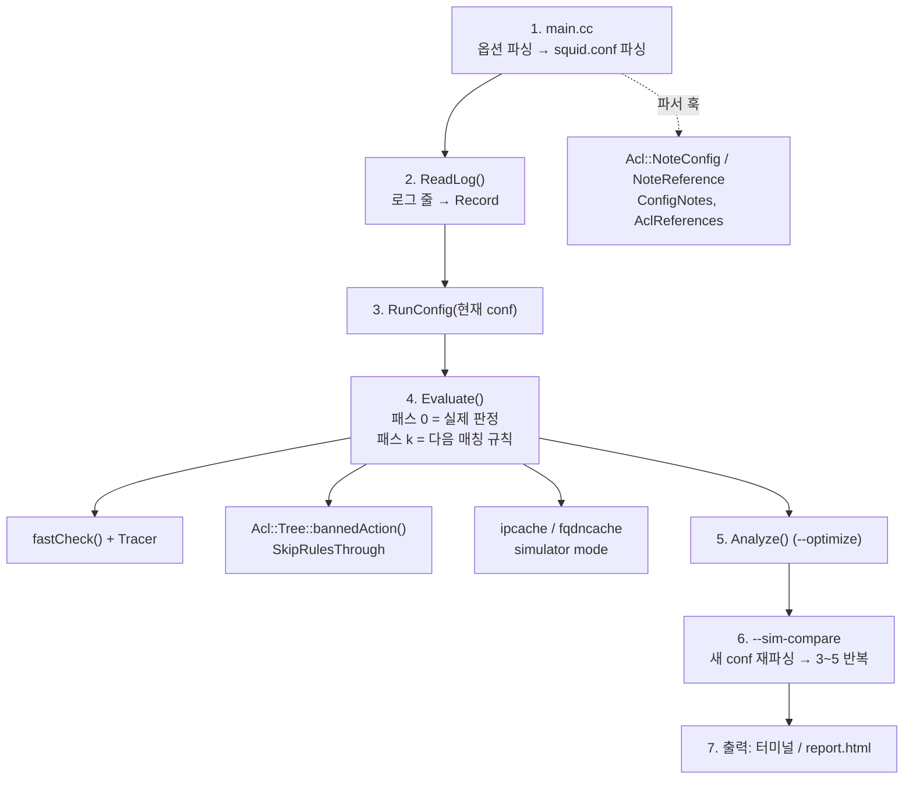

# 설계

> 이 문서의 구조와 메커니즘은 squid 4.10 기준으로 쓰였고 7.7에도 그대로 적용됩니다.
> 7.7에서 달라진 함수·타입과 훅 위치는 [PORTING-7.7.md](PORTING-7.7.md)에 있습니다.

판정은 Squid 원본 ACL 엔진(`ACLChecklist::fastCheck()`)이 내립니다. 시뮬레이터는 로그 한 줄로 가짜 요청을 만들어
엔진에 넣고, 몇 개의 훅으로 엔진이 무엇을 평가했는지 관찰할 뿐입니다. 그래서 별도 프로그램이 아니라
squid 바이너리 안의 다른 실행 경로로 만들었습니다.

## 실행 흐름

설정 파싱까지는 운영 squid와 똑같이 진행하고, 데몬화·포트 오픈·캐시 초기화 전에 `AclSimulator::Run()`으로
갈라져 끝납니다. 따라서 실행 중인 squid와 충돌하지 않습니다.

| 단계 | 함수 | 입력 → 출력 |
|---|---|---|
| 1 | `SquidMain()` | 명령행 → 파싱된 `Config` (`Config.accessList.http`, `Config.aclList`) |
| 2 | `ReadLog()`, `ParseLine()` | 로그 줄 → `Record` (파싱 실패 줄도 SKIP으로 보관) |
| 3 | `RunConfig()` | `Record` 배열 → `ConfigRun` (규칙 목록, `Decision` 배열, 집계) |
| 4 | `Evaluate()` | `Record` → `Decision` (판정, 판정 규칙, 매칭 규칙 목록, UNSURE ACL, trace, 로그 비교) |
| 5 | `Analyze()` | 파서 노트 + 규칙 목록 + 집계 → `Finding` 목록 |
| 6 | `parseConfigFile(new)` + 3~5 | 새 conf로 두 번째 `ConfigRun` |
| 7 | `PrintDecision()`, `PrintChanges()`, `PrintRunSummary()`, `PrintFindings()`, `WriteReport()` | 터미널, HTML |

## 핵심 메커니즘

### 가짜 요청

| 로그 필드 | 넣는 곳 | 영향받는 ACL |
|---|---|---|
| `%>a` | `request->client_addr` (및 `indirect_client_addr`) | `src`, `srcdomain` |
| `%la` + 포트 | `request->my_addr` (포트 = `--sim-port` 또는 첫 `http_port`) | `localip`(`myip`), `localport` |
| 같은 포트의 `http_port` name | `request->myportname` | `myportname` |
| `%rm`, `%ru` | `HttpRequest::FromUrl()` (CONNECT는 `host:port`) | `method`, `dstdomain`, `dst`, `port`, `proto`, `url_regex`, `urlpath_regex` |
| `%rv` | `request->http_ver` | — |
| `%tl` | `squid_curtime`, `current_time`, 프로세스 `TZ` | `time` |
| `%Ss`, `%>Hs` | 입력에 쓰지 않고 결과 비교에만 | — |

### 관찰 훅: `ACLChecklist::Tracer`

Squid는 `http_access` 줄들을 OR 트리(`Acl::Tree`) 아래 줄마다 AND 노드(`http_access#N`)로 만들고, 자식을 평가할
때마다 `ACLChecklist::matchChild()`를 거칩니다. 여기서 `Tracer(parent, child, 1|0)`를 부르므로, 부모가 트리인
이벤트 = 규칙 단위 결과, 부모가 규칙인 이벤트 = ACL 단위 결과입니다. AND 노드는 첫 불일치에서 멈추므로 trace도
Squid의 단락 평가 순서를 그대로 보여줍니다. `fastCheck()`에서 `goAsync()`가 거절되면 `Tracer(…, -1)`을 보내
해당 ACL을 UNSURE로 표시합니다.

로그에 없는 데이터를 보는 ACL 타입(`browser`, `req_header`, `proxy_auth`, `external`, `maxconn`, `note` 등 32종)은
결과가 나와도 UNSURE로 표시합니다. 판정을 바꿀 수 있는 것은 패스 0에서 판정 규칙까지 평가된 ACL뿐이므로
UNSURE는 패스 0의 기록만으로 정합니다. AUTH·DUNNO 판정은 그 판정을 낸 ACL을 더해 항상 UNSURE입니다.

### 매칭되는 모든 규칙: `ACLChecklist::SkipRulesThrough`

Squid는 첫 매칭에서 멈추므로, 뒤에서 허용했을 규칙을 알려면 다시 평가해야 합니다. 패스 0은 실제 판정이고,
패스 k는 `SkipRulesThrough` = 직전 승자의 위치로 두고 다시 `fastCheck()`합니다. `Acl::Tree::bannedAction()`은
`OrNode::doMatch()`가 규칙마다 묻는 "이 규칙 건너뛸까" 지점이라 위치 조건 하나만 더했습니다. 승자 이전 규칙은
어차피 불일치였으므로 "승자까지 건너뛰기"는 "승자 다음부터 계속"과 같습니다. 비용은 요청당 (매칭 규칙 수 + 1)번 평가입니다.

### 오프라인 DNS

`dst`, `srcdomain`, IP URL의 `dstdomain`은 평소 비동기 DNS를 기다립니다. 시뮬레이터는 이벤트 루프를 돌리지
않으므로 `ipcache_gethostbyname()` / `fqdncache_gethostbyaddr()`의 캐시 미스 분기를 바꿨습니다.

- `--sim-dns off`(기본): 조회하지 않습니다. `hosts_file` 항목은 `parseEtcHosts()`로 캐시에 미리 들어 있어 동작합니다. 나머지는 UNSURE.
- `--sim-dns system`: `getaddrinfo()`/`getnameinfo()`로 동기 조회해 고정 엔트리로 캐시하고, 실패한 이름도 기억합니다.
  체크리스트에 "조회 완료"를 미리 표시해, 실패는 운영 squid가 조회 실패 뒤 하는 것처럼 불일치로 처리됩니다.

### 시간

`%tl`을 UTC epoch로 바꿔 `squid_curtime`에 넣고, 프로세스 `TZ`를 로그의 오프셋(예: `SIM-09:00`)으로 맞춥니다.
`acl time`은 `localtime(squid_curtime)`을 쓰므로 시뮬레이터 서버의 타임존과 관계없이 프록시가 본 현지 시각으로 판정합니다.

### 파서 노트 (`--optimize`)

포함/중복/내장 재정의 항목은 별도 파서를 만들지 않고, Squid 파서가 이미 cache.log에 경고를 내는 자리에서
`Acl::NoteConfig()`로 파일:줄번호, ACL 이름과 타입과 함께 기록합니다. 그래서 파일에서 읽은 값(`"/etc/squid/blocked.txt"`)도
포함됩니다. 기록은 `Acl::CollectConfigNotes`가 켜졌을 때(`--simulate`, `--optimize`)만 하고, Squid 기본 설정 파싱 중의
노트는 버립니다. 참조 횟수는 규칙과 `any-of`/`all-of`가 ACL 이름을 풀 때(`InnerNode::lineParse()`) 대소문자 구분 없이 셉니다.

도달 불가·중복 규칙은 규칙의 ACL 이름 집합으로 판단합니다. 앞 규칙의 ACL 집합(모든 요청에 매칭되는 `all`류 제외)이
뒤 규칙 ACL 집합의 부분집합이면, 뒤 규칙이 매칭되는 모든 요청에서 앞 규칙도 매칭되므로 뒤 규칙은 판정할 수 없습니다.

## 소스 수정 내역 (squid 4.10)

| 파일 | 줄 | 바꾼 내용 | 옵션 없이 실행할 때 영향 |
|---|---|---|---|
| `src/AclSimulator.cci` (신규) | +1559 | 로그 파싱, 재생, 다중 패스, 비교, 최적화, 터미널/HTML 출력 | 없음 |
| `src/main.cc` | +81 / −2 | 긴 옵션 7개, 도움말, `.cci` 포함, 파싱 직후 `Run()` 후 종료 | 없음 |
| `src/acl/Checklist.h`, `.cc` | +9, +7 | `Tracer`, `SkipRulesThrough`, `matchChild()`·`goAsync()`의 훅 호출 | 없음 (nullptr / −1) |
| `src/acl/Tree.cc` | +3 / −1 | `bannedAction()`의 위치 조건 | 없음 |
| `src/acl/Acl.h`, `Acl.cc` | +34, +76 | `CollectConfigNotes`, 노트·참조·내장 ACL 기록 | 없음 (스위치 꺼짐) |
| `src/acl/InnerNode.cc` | +1 | `NoteReference()` | 없음 |
| `src/acl/DomainData.cc`, `Ip.cc`, `RegexData.cc` | +3, +5, +6 | 기존 경고 지점의 노트 기록 | 없음 |
| `src/external_acl.cc` | +4 | helper 미초기화 시 DUNNO (NULL 역참조 방지) | 없음 (운영 중엔 항상 초기화) |
| `src/ipcache.h`, `.cc` | +5, +63 | `ipcache_simulator_mode` 0/1/2 | 없음 (기본 0) |
| `src/fqdncache.h`, `.cc` | +3, +40 | `fqdncache_simulator_mode` | 없음 (기본 0) |
| `src/globals.h`, `src/cache_cf.cc` | +1, +3 / −2 | `opt_simulate`: 설정이 가리키는 파일(`mime.conf` 등)이 없어도 경고만 함 (squid 7.7은 `cache_log`를 시뮬레이터 분기 뒤에 열어 따로 막을 필요 없음) | 없음 (기본 0) |

시뮬레이터 바깥의 `scripts/squid-sim`은 Python 스크립트로, 패치한 squid를 실행하는 진입점이자 실행 중인 squid의 캐시 매니저
(`/squid-internal-mgr/`)를 읽는 도구입니다. 캐시 매니저 쪽은 Squid 소스를 고치지 않고 HTTP GET만 씁니다 ([MANAGER.md](MANAGER.md)).

`AclSimulator.cci`를 `.h`가 아닌 `.cci`로 둔 이유: `Makefile.am`을 고치지 않기 위해 `main.cc`가 포함하는데,
`make check`의 testHeaders가 `src/*.h`를 하나씩 `-Werror`로 컴파일하기 때문입니다 (Squid의 `cf_parser.cci`와 같은 관례).
