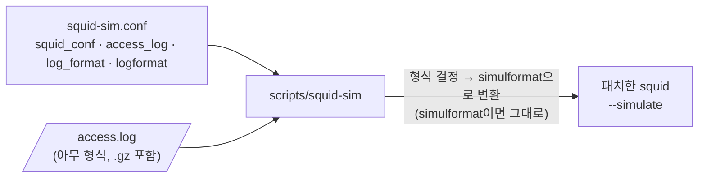

# 로그 형식과 시뮬레이터 설정 파일 (squid-sim.conf)

access.log 형식은 사이트마다 다릅니다. 기본 `squid` 형식을 그대로 쓰는 곳도 있고, `combined`를 쓰거나
직접 정의한 `logformat`을 쓰는 곳도 있습니다. 그래서 형식 정보는 squid.conf가 아니라 시뮬레이터 전용 설정
파일 `squid-sim.conf`에서 관리합니다. 운영 squid.conf의 로그 설정은 바꾸지 않아도 됩니다.



squid 바이너리는 지금처럼 `simulformat` 한 가지만 읽습니다. 형식 판별과 변환은 `scripts/squid-sim`이 하고,
변환한 사본은 개인 임시 디렉터리에 두었다가 실행이 끝나면 지웁니다. 원본 로그는 읽기만 합니다.

## 설정 파일 위치

`scripts/squid-sim`은 다음 순서로 처음 찾은 파일 하나를 씁니다.

1. `--sim-conf FILE`
2. 환경 변수 `SQUID_SIM_CONF`
3. `/etc/squid/squid-sim.conf`
4. 저장소 최상위의 `squid-sim.conf` (모든 값이 `auto`인 예시 파일)

squid 자신은 이 파일을 읽지 않습니다. 명령행 옵션은 항상 설정 파일보다 우선합니다.

## 지시어

한 줄에 하나씩 쓰고, `#`로 시작하는 줄은 주석입니다. `auto`는 "squid-sim이 알아서 정함"입니다.
상대 경로는 설정 파일이 있는 디렉터리를 기준으로 합니다.

| 지시어 | 기본값 | 뜻 |
|---|---|---|
| `squid_conf` | `/etc/squid/squid.conf` | 시뮬레이션할 squid.conf (`-f`가 없을 때) |
| `access_log` | `auto` | `--simulate`가 없을 때 재생할 로그. `auto` = squid_conf의 첫 파일 `access_log`. squid.conf에 `access_log` 줄이 아예 없으면 squid 기본값 `/var/log/squid/access.log` |
| `log_format` | `auto` | 로그 형식 이름. `auto`는 아래 "자동 판별" 참고 |
| `logformat 이름 형식` | — | 형식 정의. squid.conf의 `logformat` 줄을 그대로 복사하면 됩니다. 여러 개 가능 |
| `local_ip` | `auto` | 형식에 `%la`가 없을 때 쓸 프록시 주소 (`localip`/`myip` ACL용). `auto` = 첫 `http_port`에 적힌 주소 |
| `log_timezone` | `local` | `%ts`(epoch)·`%tg`(GMT)처럼 UTC로 남는 시각을 프록시 현지 시각으로 바꿀 오프셋. `local`은 이 서버의 타임존(서머타임 포함), 또는 `+0900` |
| `sim_port` | `auto` | squid의 `--sim-port` 기본값 |
| `sim_dns` | `auto` | squid의 `--sim-dns` 기본값 (`off`/`system`) |
| `manager_url` | `auto` | `squid-sim -m`의 `--url` 기본값 |
| `manager_password_env` | (없음) | `squid-sim -m`의 `--password-env` 기본값 |

`logformat` 줄은 끝까지가 형식이므로 줄 끝 주석을 붙이지 마세요.

## 예시

기본 설정의 Ubuntu squid (squid.conf에 `access_log` 줄 없음 → `squid` 형식): 설정 파일 없이 바로 됩니다.

```bash
sudo scripts/squid-sim                       # /etc/squid/squid.conf + /var/log/squid/access.log
sudo scripts/squid-sim --report report.html  # 같은 대상으로 HTML 리포트
```

직접 정의한 형식을 쓰는 사이트 (`/etc/squid/squid-sim.conf`):

```
squid_conf    /etc/squid/squid.conf
access_log    /var/log/squid/access.log
logformat     site %>a %la [%tg] %Ss/%03>Hs %<st "%rm %ru" %tr "%{User-Agent}>h" %un
log_format    site
log_timezone  +0900
```

로그 서버에 모아 둔 로그를 다른 서버에서 돌릴 때:

```
squid_conf    /srv/proxy-a/squid.conf
local_ip      10.1.2.3          # 그 프록시의 주소 (로그에 %la가 없으므로)
log_timezone  +0900             # 그 프록시의 타임존 (%ts는 UTC)
```

```bash
scripts/squid-sim --sim-conf proxy-a.conf --simulate /srv/proxy-a/access.log.3.gz --report a.html
```

변환 결과만 보려면 `--convert`를 씁니다.

```bash
scripts/squid-sim --convert /var/log/squid/access.log | head
```

## 자동 판별 (`log_format auto`)

로그의 주석이 아닌 처음 50줄을 아래 후보에 차례로 맞춰 보고, 가장 많이 맞는 형식을 고릅니다.
같은 수면 앞 순서가 이깁니다.

1. squid_conf의 `access_log`가 쓰는 형식 (`access_log` 줄이 없으면 squid 기본값 `squid`)
2. squid-sim.conf의 `logformat`
3. squid_conf의 `logformat`
4. 미리 정의된 형식: `simulformat`, `squid`, `common`, `combined`, `referrer`

고른 형식과 근거는 stderr에 나옵니다.

```text
squid-sim: /var/log/squid/access.log is logformat squid (detected, 50 of 50 sample lines match)
squid-sim: converted 179 lines to simulformat (0 did not match and are reported as skipped)
```

아무 형식도 맞지 않으면 시도한 형식 목록과 함께 멈춥니다. 그때는 squid-sim.conf에 `logformat`과 `log_format`을 적어 주세요.

## 형식에 따라 달라지는 것

시뮬레이터에 꼭 필요한 필드는 `%>a`(클라이언트)와 `%ru`(URL) 두 개입니다. 나머지는 있으면 쓰고, 없으면 아래처럼 대신합니다.

| 필드 | 없을 때 | 영향 |
|---|---|---|
| 시각 `%tl` / `%tg` / `%ts` | 현재 시각 (경고 출력) | `acl time` |
| `%la` | `local_ip`, 없으면 "주소 없음" | `localip`/`myip` ACL (squid.conf가 이 ACL을 쓰는데 값이 없으면 경고) |
| `%rm` | URL에 `://`가 있으면 GET, 없으면 CONNECT | `method` ACL |
| `%rv` | 1.1 | — |
| `%>Hs`, `%<st` | `-` | 출력에만 쓰임 |
| `%Ss` | `-` | 실제 로그와의 비교(`same`/`DIFF`)를 하지 않음 |

나머지 코드(`%tr`, `%un`, `%{User-Agent}>h`, `%mt` 등)는 위치만 맞추고 버립니다. 너비·정렬·인코딩 수식어
(`%6tr`, `%03>Hs`, `%[un`, `%"ru`)와 `{인자}`도 squid 문법대로 읽습니다.
형식에 맞지 않는 줄은 줄 번호를 유지한 채 "건너뜀(SKIP)"으로 보고되고, 주석 줄과 빈 줄은 그대로 둡니다.

`%tl`은 프록시가 남긴 현지 시각이라 그대로 쓰지만, `%ts`·`%tg`는 UTC라서 `log_timezone`으로 현지 시각을
만듭니다. 다른 타임존의 프록시 로그를 돌릴 때는 `log_timezone`을 꼭 맞춰 주세요.

## 검증

`scripts/test.sh`의 `[logformat]` 단계가 같은 요청을 세 가지 형식으로 적은 로그를 재생해,
요청별 판정·판정 규칙·실제 로그 비교가 `simulformat` 원본과 한 줄도 다르지 않은지 확인합니다.

| 로그 | 설정 | 확인하는 것 |
|---|---|---|
| `tests/access.log` | `--sim-conf /dev/null` | simulformat은 변환 없이 squid에 그대로 전달 |
| `tests/access-squid.log` | `tests/sim-squid.conf` | `squid` 형식 자동 판별, `%ts`(UTC) + `log_timezone`, `%la` 없음 + `local_ip`, 설정 파일의 `squid_conf`/`access_log` |
| 위 파일의 `.gz` | 같음 | gzip 로그 |
| `tests/access-custom.log` | `tests/sim-custom.conf` | 설정 파일에 정의한 형식, `%tg`, 따옴표 안 공백, 쓰지 않는 코드 |

테스트 로그의 월요일 오전 요청과 토요일 요청은 `acl time`으로 판정이 갈리므로, 시각 변환이 틀리면 테스트가 실패합니다.
Ubuntu 20.04(squid 4.10)와 26.04(squid 7.7) 테스트 서버에서 통과했습니다. 두 서버의 실제 squid(기본 설정, `squid` 형식 로그
약 180줄)도 설정 파일 없이 `sudo scripts/squid-sim`으로 자동 판별·변환했고, 실제 로그와 판정이 다른 요청은 0건이었습니다.
