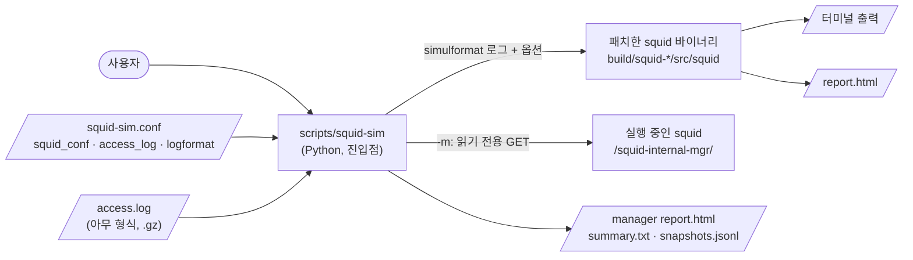
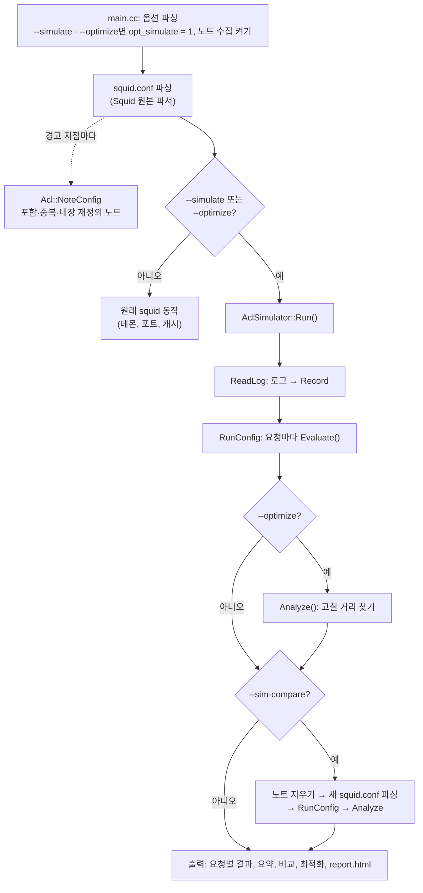
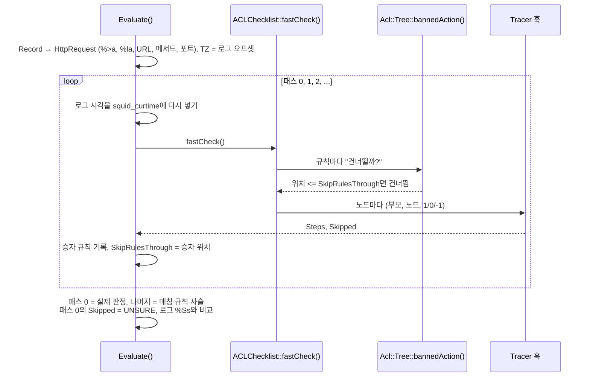
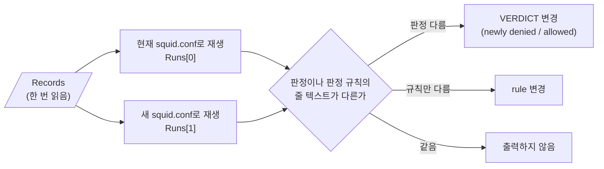
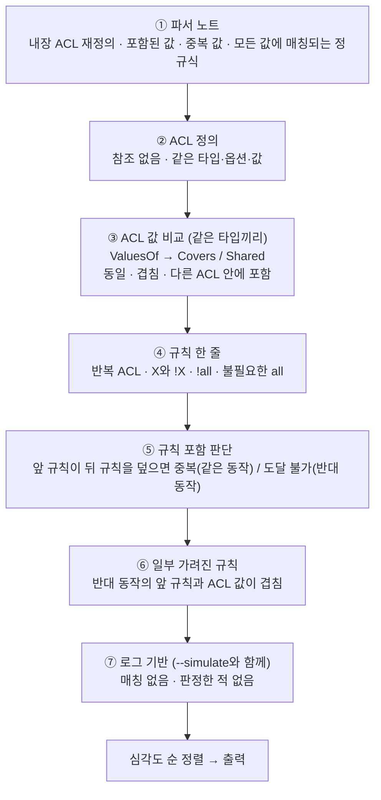
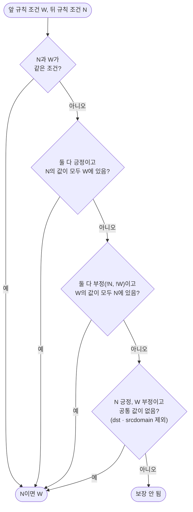
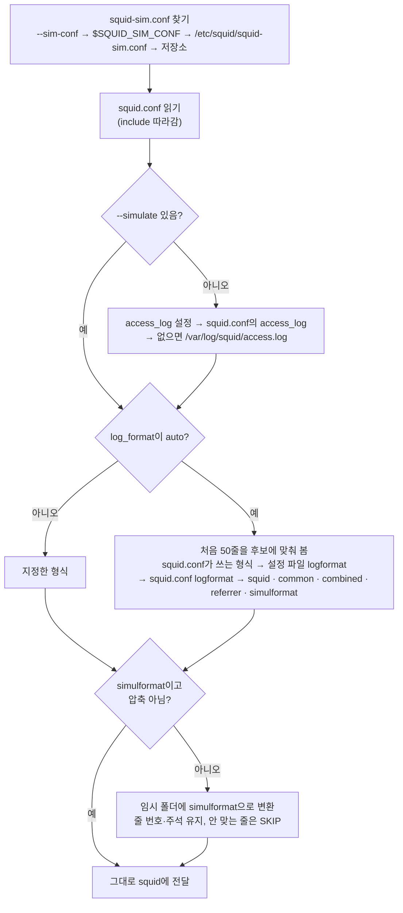
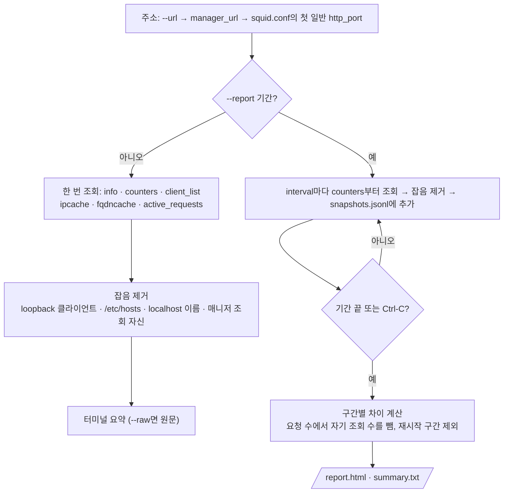
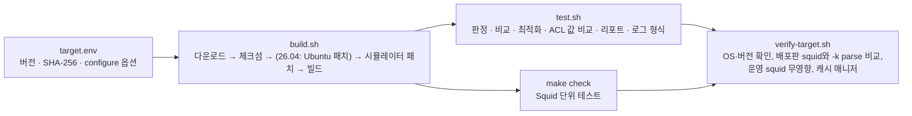

# 전체 구조와 흐름

이 문서는 저장소의 모든 기능을 그림으로 정리합니다. 각 단계의 자세한 설명은 끝의 문서 목록에 있습니다.

## 1. 구성 요소

| 구성 요소 | 하는 일 |
|---|---|
| `scripts/squid-sim` | 설정 파일 읽기, 로그 형식 판별·변환, 패치한 squid 실행, 캐시 매니저 조회·기록 |
| `squid-sim.conf` | 대상 squid.conf, 로그 경로, 로그 형식, 매니저 주소 |
| 패치한 squid | 설정 파싱, 요청 재생, 판정, 비교, 최적화 분석, HTML 리포트 |
| `scripts/build.sh` · `test.sh` · `verify-target.sh` | 공식 소스 다운로드·패치·빌드, 기능 테스트, 대상 OS 전체 검증 |

## 2. 패치한 squid 안의 흐름

설정 파싱까지는 운영 squid와 같고, 데몬화·포트 열기·캐시 초기화 전에 시뮬레이터로 갈라집니다.

## 3. 요청 하나의 판정 (Evaluate)

Squid는 첫 매칭 규칙에서 멈추므로, 뒤에서 매칭될 규칙을 찾으려고 같은 요청을 여러 번 평가합니다.

| 결과 | 뜻 |
|---|---|
| `ALLOW` / `DENY` | 판정과 판정 규칙(`http_access#N`) 또는 `implicit`(어느 규칙도 안 맞아 마지막 규칙의 반대) |
| `matching` | 그 요청에 매칭되는 규칙 전부, 판정 규칙이 없었다면의 결과 |
| `UNSURE` | 로그에 없는 정보(헤더, 인증 등)나 DNS가 필요한 ACL이 판정에 관여 |
| `same` / `DIFF` | 실제 로그의 `%Ss`(TCP_DENIED 여부)와 같은지 |
| `SKIP` | 읽을 수 없는 줄이나 URL |

## 4. 설정 비교 (--sim-compare)

규칙이 추가되면 번호가 밀리므로 번호가 아니라 규칙 줄 텍스트로 비교합니다.

## 5. 최적화 (--optimize)

### 규칙 포함 판단

앞 규칙의 조건 하나하나가, 뒤 규칙의 어떤 조건으로 보장되면 뒤 규칙은 판정할 기회가 없습니다.

| 타입 | 값 비교 방법 |
|---|---|
| `src`, `dst`, `localip` | IPv4/IPv6 주소 범위 (128비트, 병합 후 이분 탐색) |
| `port`, `localport` | 포트 범위 |
| `dstdomain`, `srcdomain` | `.example.com` = 그 도메인과 하위 도메인 (접미사 조회) |
| `method`, `proto`, `myportname` | 값 집합 |

## 6. 로그 형식 판별과 변환

| 형식에 없을 때 | 대신 쓰는 값 |
|---|---|
| `%la` | `local_ip`, 없으면 주소 없음 (localip ACL이 있으면 경고) |
| `%tl` | `%tg`·`%ts`를 `log_timezone`으로 현지 시각으로, 셋 다 없으면 현재 시각 (경고) |
| `%rm` | URL에 `://`가 있으면 GET, 없으면 CONNECT |

## 7. 캐시 매니저 (squid-sim -m)

`shutdown`, `reconfigure` 같은 상태를 바꾸는 페이지는 보내지 않고 거부합니다.

## 8. 빌드와 검증

## 문서

| 문서 | 내용 |
|---|---|
| [USAGE.md](USAGE.md) | 옵션, 출력 읽는 법, 최적화 항목 전체 |
| [LOGFORMAT.md](LOGFORMAT.md) | squid-sim.conf, 로그 형식 판별과 변환 |
| [MANAGER.md](MANAGER.md) | 캐시 매니저 조회·기록 |
| [DESIGN-VERIFICATION.md](DESIGN-VERIFICATION.md) | 설계·검증 문서 전체 (재검토 결과 포함) |
| [DESIGN.md](DESIGN.md) | 핵심 메커니즘, 소스 수정 내역 |
| [VERIFICATION.md](VERIFICATION.md) | 검증 환경과 결과 |
